# Compétition : validation puis évaluation verrouillée


Ce rapport est généré à partir des artefacts présents. Un résultat absent n'est pas considéré exécuté.

Candidat verrouillé : **Tmax C0_direct_crps / Tmin D1_ddm_crps**, **admissible**. CRPS test : **1.748986 °C** pour Tmax, **1.031040 °C** pour Tmin. Cette paire reste celle choisie avant lecture du test.

Sur 11 exports préenregistrés, **10 sont admissibles**. Les ablations ne remplacent pas le candidat après lecture du test.

La référence R0 exacte obtient **1.698885 / 1.064129 °C** (Tmax/Tmin). Elle gagne face au participant pour Tmax ; le participant améliore Tmin. La diffusion n'apporte donc pas un gain global garanti.

**DDPM D0 est éliminé** : 19152 valeurs de Tmin sortent de [−30,20] °C ; le minimum simulé atteint **-1933.216 °C**. Son CRPS Tmin brut est **2.619998 °C** et le kit retourne None. Un bon score de validation ne rend donc pas cette configuration admissible.

Détails : [diagnostic_echec_ddpm.md](diagnostic_echec_ddpm.md), fondé sur le NPZ et les checkpoints figés.


Le participant présente les diagnostics suivants :

| variable | bias | coverage80 | width80 | brier |
| --- | --- | --- | --- | --- |
| max | -1.4109 | 0.64 | 5.01962 | 0.346021 |
| min | -0.785235 | 0.84 | 5.67908 | 0.121736 |


Le biais négatif et la couverture 80 % de 64 % des maxima (16/25 ans) montrent des chaleurs sous-estimées et une sous-couverture sur ce test. Les minima ont une couverture de 84 % (21/25) et conservent un biais froid malgré le gain de CRPS face à R0. Ces fréquences restent imprécises avec 25 années.


Les CRPS, twCRPS, biais et largeurs sont en °C ; couvertures, Brier et probabilités sont sans unité.


## Validation : agrégation des mélanges


| variable | model | crps | twcrps | coverage80 | width80 | bias | brier | fold_count |
| --- | --- | --- | --- | --- | --- | --- | --- | --- |
| max | C0_direct_crps | 1.14226 | 0.403289 | 0.733333 | 5.14446 | -0.206869 | 0.16628 | 3 |
| max | D0_ddpm | 1.09716 | 0.389177 | 0.766667 | 5.14004 | -0.273135 | 0.153721 | 3 |
| max | D1_ddm_crps | 1.12039 | 0.386446 | 0.8 | 5.49207 | -0.113684 | 0.155856 | 3 |
| max | D2_ddm_tail_lambda0.5 | 1.1216 | 0.385844 | 0.8 | 5.51597 | -0.128532 | 0.155961 | 3 |
| max | D2_ddm_tail_lambda1 | 1.12507 | 0.386949 | 0.8 | 5.44707 | -0.14997 | 0.155696 | 3 |
| max | D2_ddm_tail_lambda2 | 1.14176 | 0.391472 | 0.8 | 5.63233 | -0.227321 | 0.158266 | 3 |
| max | D3_ddm_anchor | 1.11093 | 0.378243 | 0.833333 | 5.65193 | 0.07995 | 0.15633 | 3 |
| max | D4_ddm_tail_anchor_lambda0.5 | 1.11163 | 0.377714 | 0.833333 | 5.67758 | 0.0651024 | 0.15621 | 3 |
| max | D4_ddm_tail_anchor_lambda1 | 1.11418 | 0.378202 | 0.8 | 5.62139 | 0.0436638 | 0.155756 | 3 |
| max | D4_ddm_tail_anchor_lambda2 | 1.1275 | 0.382432 | 0.8 | 5.79941 | -0.0336875 | 0.158433 | 3 |
| max | R0_gaussian | 1.17698 | 0.417176 | 0.733333 | 4.95119 | -0.247299 | 0.165423 | 3 |
| max | R1_gev | 1.17584 | 0.420941 | 0.7 | 4.74217 | -0.262413 | 0.170444 | 3 |
| max | R2_empirical | 1.16224 | 0.409258 | 0.733333 | 5.10009 | -0.219062 | 0.185997 | 3 |
| min | C0_direct_crps | 1.20088 | 0.417724 | 0.733333 | 4.58717 | 0.310431 | 0.153479 | 3 |
| min | D0_ddpm | 1.14301 | 0.401878 | 0.766667 | 5.06792 | 0.0453901 | 0.147724 | 3 |
| min | D1_ddm_crps | 1.16694 | 0.409639 | 0.766667 | 5.3867 | 0.271047 | 0.150983 | 3 |
| min | D2_ddm_tail_lambda0.5 | 1.17705 | 0.412023 | 0.766667 | 5.29271 | 0.334729 | 0.152106 | 3 |
| min | D2_ddm_tail_lambda1 | 1.18327 | 0.415008 | 0.766667 | 5.25176 | 0.356817 | 0.152997 | 3 |
| min | D2_ddm_tail_lambda2 | 1.18806 | 0.420717 | 0.766667 | 5.26234 | 0.40548 | 0.153974 | 3 |
| min | D3_ddm_anchor | 1.17323 | 0.407424 | 0.866667 | 5.59939 | 0.464607 | 0.14869 | 3 |
| min | D4_ddm_tail_anchor_lambda0.5 | 1.18652 | 0.410074 | 0.866667 | 5.51676 | 0.528289 | 0.150346 | 3 |
| min | D4_ddm_tail_anchor_lambda1 | 1.19287 | 0.412849 | 0.866667 | 5.49483 | 0.550377 | 0.151239 | 3 |
| min | D4_ddm_tail_anchor_lambda2 | 1.19859 | 0.417937 | 0.866667 | 5.47372 | 0.59904 | 0.151826 | 3 |
| min | R0_gaussian | 1.22105 | 0.428737 | 0.733333 | 4.83554 | 0.382022 | 0.155736 | 3 |
| min | R1_gev | 1.23363 | 0.425159 | 0.7 | 4.46084 | 0.377898 | 0.157216 | 3 |
| min | R2_empirical | 1.24856 | 0.42791 | 0.733333 | 4.8822 | 0.379268 | 0.16292 | 3 |


Source complète : [validation_summary.csv](../artifacts/competition/validation_summary.csv).


Intervalles centraux : couvertures et largeurs pour les trois niveaux.

| variable | model | coverage50 | width50 | coverage80 | width80 | coverage90 | width90 |
| --- | --- | --- | --- | --- | --- | --- | --- |
| max | C0_direct_crps | 0.533333 | 2.57598 | 0.733333 | 5.14446 | 0.9 | 6.56674 |
| max | D0_ddpm | 0.6 | 2.80131 | 0.766667 | 5.14004 | 0.9 | 6.35947 |
| max | D1_ddm_crps | 0.566667 | 2.939 | 0.8 | 5.49207 | 0.933333 | 7.03048 |
| max | D2_ddm_tail_lambda0.5 | 0.566667 | 2.96329 | 0.8 | 5.51597 | 0.933333 | 7.04663 |
| max | D2_ddm_tail_lambda1 | 0.566667 | 2.93396 | 0.8 | 5.44707 | 0.933333 | 6.93817 |
| max | D2_ddm_tail_lambda2 | 0.6 | 3.01766 | 0.8 | 5.63233 | 0.933333 | 7.15904 |
| max | D3_ddm_anchor | 0.566667 | 3.04414 | 0.833333 | 5.65193 | 0.966667 | 7.2651 |
| max | D4_ddm_tail_anchor_lambda0.5 | 0.566667 | 3.06454 | 0.833333 | 5.67758 | 0.966667 | 7.28916 |
| max | D4_ddm_tail_anchor_lambda1 | 0.566667 | 3.02745 | 0.8 | 5.62139 | 0.9 | 7.2025 |
| max | D4_ddm_tail_anchor_lambda2 | 0.566667 | 3.10487 | 0.8 | 5.79941 | 0.933333 | 7.39994 |
| max | R0_gaussian | 0.533333 | 2.57976 | 0.733333 | 4.95119 | 0.833333 | 6.30897 |
| max | R1_gev | 0.533333 | 2.49979 | 0.7 | 4.74217 | 0.8 | 6.06853 |
| max | R2_empirical | 0.533333 | 2.0676 | 0.733333 | 5.10009 | 0.9 | 6.40262 |
| min | C0_direct_crps | 0.6 | 2.32179 | 0.733333 | 4.58717 | 0.833333 | 6.07829 |
| min | D0_ddpm | 0.566667 | 2.58499 | 0.766667 | 5.06792 | 0.8 | 6.62097 |
| min | D1_ddm_crps | 0.666667 | 2.81385 | 0.766667 | 5.3867 | 0.933333 | 6.86495 |
| min | D2_ddm_tail_lambda0.5 | 0.666667 | 2.74983 | 0.766667 | 5.29271 | 0.9 | 6.7983 |
| min | D2_ddm_tail_lambda1 | 0.666667 | 2.7582 | 0.766667 | 5.25176 | 0.9 | 6.76228 |
| min | D2_ddm_tail_lambda2 | 0.7 | 2.75073 | 0.766667 | 5.26234 | 0.933333 | 6.7064 |
| min | D3_ddm_anchor | 0.666667 | 2.93355 | 0.866667 | 5.59939 | 0.933333 | 7.22857 |
| min | D4_ddm_tail_anchor_lambda0.5 | 0.633333 | 2.8662 | 0.866667 | 5.51676 | 0.9 | 7.12172 |
| min | D4_ddm_tail_anchor_lambda1 | 0.633333 | 2.8639 | 0.866667 | 5.49483 | 0.9 | 7.09774 |
| min | D4_ddm_tail_anchor_lambda2 | 0.633333 | 2.88063 | 0.866667 | 5.47372 | 0.9 | 7.04342 |
| min | R0_gaussian | 0.6 | 2.54634 | 0.733333 | 4.83554 | 0.866667 | 6.21219 |
| min | R1_gev | 0.6 | 2.25408 | 0.7 | 4.46084 | 0.8 | 5.8888 |
| min | R2_empirical | 0.6 | 2.27333 | 0.733333 | 4.8822 | 0.833333 | 5.92758 |


## Validation : scores des mélanges par fold et variante


| variable | fold | model | tail_lambda | crps | twcrps |
| --- | --- | --- | --- | --- | --- |
| max | F1 | R0_gaussian | 0 | 1.18946 | 0.412457 |
| max | F1 | R1_gev | 0 | 1.18581 | 0.411326 |
| max | F1 | R2_empirical | 0 | 1.1769 | 0.401202 |
| max | F1 | D0_ddpm | 0 | 1.18056 | 0.403257 |
| max | F1 | C0_direct_crps | 0 | 1.1734 | 0.397608 |
| max | F1 | D1_ddm_crps | 0 | 1.17865 | 0.399509 |
| max | F1 | D2_ddm_tail_lambda0.5 | 0.5 | 1.17906 | 0.399745 |
| max | F1 | D2_ddm_tail_lambda1 | 1 | 1.17918 | 0.402187 |
| max | F1 | D2_ddm_tail_lambda2 | 2 | 1.17952 | 0.401183 |
| max | F1 | D3_ddm_anchor | 0 | 1.19435 | 0.39781 |
| max | F1 | D4_ddm_tail_anchor_lambda0.5 | 0.5 | 1.19406 | 0.39785 |
| max | F1 | D4_ddm_tail_anchor_lambda1 | 1 | 1.19361 | 0.398465 |
| max | F1 | D4_ddm_tail_anchor_lambda2 | 2 | 1.19499 | 0.398341 |
| min | F1 | R0_gaussian | 0 | 0.997888 | 0.0118108 |
| min | F1 | R1_gev | 0 | 0.960836 | 0.0153927 |
| min | F1 | R2_empirical | 0 | 0.986079 | 0.032633 |
| min | F1 | D0_ddpm | 0 | 0.908305 | 0.0100897 |
| min | F1 | C0_direct_crps | 0 | 0.943877 | 0.015629 |
| min | F1 | D1_ddm_crps | 0 | 0.912116 | 0.0183187 |
| min | F1 | D2_ddm_tail_lambda0.5 | 0.5 | 0.915213 | 0.0193858 |
| min | F1 | D2_ddm_tail_lambda1 | 1 | 0.918145 | 0.020216 |
| min | F1 | D2_ddm_tail_lambda2 | 2 | 0.902141 | 0.0190999 |
| min | F1 | D3_ddm_anchor | 0 | 0.867379 | 0.014064 |
| min | F1 | D4_ddm_tail_anchor_lambda0.5 | 0.5 | 0.870652 | 0.0148621 |
| min | F1 | D4_ddm_tail_anchor_lambda1 | 1 | 0.873531 | 0.0154808 |
| min | F1 | D4_ddm_tail_anchor_lambda2 | 2 | 0.862984 | 0.014174 |
| max | F2 | R0_gaussian | 0 | 1.46119 | 0.824535 |
| max | F2 | R1_gev | 0 | 1.4944 | 0.833732 |
| max | F2 | R2_empirical | 0 | 1.46311 | 0.785496 |
| max | F2 | D0_ddpm | 0 | 1.34413 | 0.754464 |
| max | F2 | C0_direct_crps | 0 | 1.44102 | 0.793041 |
| max | F2 | D1_ddm_crps | 0 | 1.34474 | 0.742148 |
| max | F2 | D2_ddm_tail_lambda0.5 | 0.5 | 1.34893 | 0.740738 |
| max | F2 | D2_ddm_tail_lambda1 | 1 | 1.35882 | 0.7419 |
| max | F2 | D2_ddm_tail_lambda2 | 2 | 1.41193 | 0.754225 |
| max | F2 | D3_ddm_anchor | 0 | 1.28304 | 0.715362 |
| max | F2 | D4_ddm_tail_anchor_lambda0.5 | 0.5 | 1.28654 | 0.714446 |
| max | F2 | D4_ddm_tail_anchor_lambda1 | 1 | 1.29436 | 0.715599 |
| max | F2 | D4_ddm_tail_anchor_lambda2 | 2 | 1.33704 | 0.726157 |
| min | F2 | R0_gaussian | 0 | 1.6248 | 0.841789 |

78 lignes au total ; le CSV conserve toutes les lignes.


Source complète : [validation_mixture.csv](../artifacts/competition/validation_mixture.csv).


## Validation : scores des graines individuelles


| variable | fold | model | seed | crps | twcrps |
| --- | --- | --- | --- | --- | --- |
| max | F1 | R0_gaussian | stat | 1.18946 | 0.412457 |
| max | F1 | R1_gev | stat | 1.18581 | 0.411326 |
| max | F1 | R2_empirical | stat | 1.1769 | 0.401202 |
| max | F1 | D0_ddpm | 0 | 1.18184 | 0.403725 |
| max | F1 | D0_ddpm | 1 | 1.18175 | 0.400753 |
| max | F1 | D0_ddpm | 2 | 1.18479 | 0.407823 |
| max | F1 | C0_direct_crps | 0 | 1.17644 | 0.400658 |
| max | F1 | C0_direct_crps | 1 | 1.17439 | 0.396973 |
| max | F1 | C0_direct_crps | 2 | 1.17401 | 0.397524 |
| max | F1 | D1_ddm_crps | 0 | 1.17755 | 0.398387 |
| max | F1 | D1_ddm_crps | 1 | 1.17844 | 0.400938 |
| max | F1 | D1_ddm_crps | 2 | 1.18112 | 0.398144 |
| max | F1 | D2_ddm_tail_lambda0.5 | 0 | 1.17799 | 0.399157 |
| max | F1 | D2_ddm_tail_lambda0.5 | 1 | 1.17874 | 0.400084 |
| max | F1 | D2_ddm_tail_lambda0.5 | 2 | 1.18154 | 0.398489 |
| max | F1 | D2_ddm_tail_lambda1 | 0 | 1.17826 | 0.3996 |
| max | F1 | D2_ddm_tail_lambda1 | 1 | 1.17924 | 0.399823 |
| max | F1 | D2_ddm_tail_lambda1 | 2 | 1.182 | 0.406338 |
| max | F1 | D2_ddm_tail_lambda2 | 0 | 1.17922 | 0.397995 |
| max | F1 | D2_ddm_tail_lambda2 | 1 | 1.18037 | 0.399707 |
| max | F1 | D2_ddm_tail_lambda2 | 2 | 1.18178 | 0.40556 |
| max | F1 | D3_ddm_anchor | 0 | 1.19611 | 0.397308 |
| max | F1 | D3_ddm_anchor | 1 | 1.19433 | 0.397614 |
| max | F1 | D3_ddm_anchor | 2 | 1.19803 | 0.398363 |
| max | F1 | D4_ddm_tail_anchor_lambda0.5 | 0 | 1.19576 | 0.39721 |
| max | F1 | D4_ddm_tail_anchor_lambda0.5 | 1 | 1.19622 | 0.397513 |
| max | F1 | D4_ddm_tail_anchor_lambda0.5 | 2 | 1.19559 | 0.398032 |
| max | F1 | D4_ddm_tail_anchor_lambda1 | 0 | 1.19501 | 0.397222 |
| max | F1 | D4_ddm_tail_anchor_lambda1 | 1 | 1.19713 | 0.397549 |
| max | F1 | D4_ddm_tail_anchor_lambda1 | 2 | 1.19304 | 0.399704 |
| max | F1 | D4_ddm_tail_anchor_lambda2 | 0 | 1.19694 | 0.397471 |
| max | F1 | D4_ddm_tail_anchor_lambda2 | 1 | 1.19884 | 0.397701 |
| max | F1 | D4_ddm_tail_anchor_lambda2 | 2 | 1.19402 | 0.399435 |
| min | F1 | R0_gaussian | stat | 0.997888 | 0.0118108 |
| min | F1 | R1_gev | stat | 0.960836 | 0.0153927 |
| min | F1 | R2_empirical | stat | 0.986079 | 0.032633 |
| min | F1 | D0_ddpm | 0 | 0.914188 | 0.00663382 |
| min | F1 | D0_ddpm | 1 | 0.896399 | 0.0106233 |
| min | F1 | D0_ddpm | 2 | 0.905783 | 0.0132922 |
| min | F1 | C0_direct_crps | 0 | 0.945721 | 0.0124802 |

198 lignes au total ; le CSV conserve toutes les lignes.


Source complète : [validation_individual.csv](../artifacts/competition/validation_individual.csv).


## Benchmark original : scores et admissibilité


| model | crps_max | crps_min | admissible | errors |
| --- | --- | --- | --- | --- |
| R0_exact | 1.69889 | 1.06413 | True | — |
| R0_gaussian | 1.70769 | 1.06449 | True | — |
| R1_gev | 1.7278 | 1.03603 | True | — |
| R2_empirical | 1.735 | 1.03015 | True | — |
| D0_ddpm | 1.75006 | 2.62 | False | min: bornes |
| C0_direct_crps | 1.74899 | 1.02704 | True | — |
| D1_ddm_crps | 1.70071 | 1.03104 | True | — |
| D2_ddm_tail | 1.70691 | 1.01464 | True | — |
| D3_ddm_anchor | 1.64919 | 0.987842 | True | — |
| D4_ddm_tail_anchor | 1.65476 | 0.978821 | True | — |
| participant | 1.74899 | 1.03104 | True | — |


Source complète : [benchmark_scores.csv](../artifacts/competition/benchmark_scores.csv).


## Diagnostics test : couverture, largeur, rang et événement


| variable | model | crps | twcrps | coverage80 | width80 | bias | brier |
| --- | --- | --- | --- | --- | --- | --- | --- |
| max | R0_exact | 1.69889 | 0.728511 | 0.64 | 4.9654 | -1.39473 | 0.342052 |
| min | R0_exact | 1.06413 | 0.15453 | 0.76 | 5.09013 | -0.855062 | 0.128053 |
| max | R0_gaussian | 1.70769 | 0.729612 | 0.64 | 5.00183 | -1.4232 | 0.342997 |
| min | R0_gaussian | 1.06449 | 0.1523 | 0.76 | 5.04866 | -0.841032 | 0.123463 |
| max | R1_gev | 1.7278 | 0.724281 | 0.64 | 4.78754 | -1.38928 | 0.347571 |
| min | R1_gev | 1.03603 | 0.149818 | 0.72 | 4.86588 | -0.877177 | 0.107309 |
| max | R2_empirical | 1.735 | 0.696773 | 0.68 | 5.23863 | -1.37415 | 0.316992 |
| min | R2_empirical | 1.03015 | 0.151386 | 0.76 | 5.2417 | -0.848047 | 0.0861664 |
| max | D0_ddpm | 1.75006 | 0.720418 | 0.64 | 4.92245 | -1.45106 | 0.342035 |
| min | D0_ddpm | 2.62 | 1.67581 | 0.76 | 6.90045 | -37.1397 | 0.145746 |
| max | C0_direct_crps | 1.74899 | 0.711283 | 0.64 | 5.01962 | -1.4109 | 0.346021 |
| min | C0_direct_crps | 1.02704 | 0.148548 | 0.72 | 4.82922 | -0.838122 | 0.104717 |
| max | D1_ddm_crps | 1.70071 | 0.694137 | 0.72 | 5.99676 | -1.43489 | 0.322092 |
| min | D1_ddm_crps | 1.03104 | 0.162567 | 0.84 | 5.67908 | -0.785235 | 0.121736 |
| max | D2_ddm_tail | 1.70691 | 0.698077 | 0.72 | 5.91473 | -1.46267 | 0.323691 |
| min | D2_ddm_tail | 1.01464 | 0.159165 | 0.84 | 5.78019 | -0.698923 | 0.11649 |
| max | D3_ddm_anchor | 1.64919 | 0.682544 | 0.76 | 6.05715 | -1.29029 | 0.309271 |
| min | D3_ddm_anchor | 0.987842 | 0.151765 | 0.88 | 5.79636 | -0.524426 | 0.110235 |
| max | D4_ddm_tail_anchor | 1.65476 | 0.685833 | 0.76 | 5.98769 | -1.31807 | 0.311328 |
| min | D4_ddm_tail_anchor | 0.978821 | 0.149098 | 0.92 | 5.87969 | -0.438114 | 0.105949 |
| max | participant | 1.74899 | 0.711283 | 0.64 | 5.01962 | -1.4109 | 0.346021 |
| min | participant | 1.03104 | 0.162567 | 0.84 | 5.67908 | -0.785235 | 0.121736 |


Source complète : [test_diagnostics.csv](../artifacts/competition/test_diagnostics.csv).


Intervalles centraux : couvertures et largeurs pour les trois niveaux.

| variable | model | coverage50 | width50 | coverage80 | width80 | coverage90 | width90 |
| --- | --- | --- | --- | --- | --- | --- | --- |
| max | R0_exact | 0.32 | 2.61751 | 0.64 | 4.9654 | 0.76 | 6.36653 |
| min | R0_exact | 0.44 | 2.68049 | 0.76 | 5.09013 | 0.96 | 6.52319 |
| max | R0_gaussian | 0.36 | 2.6267 | 0.64 | 5.00183 | 0.76 | 6.36186 |
| min | R0_gaussian | 0.44 | 2.59555 | 0.76 | 5.04866 | 0.96 | 6.52933 |
| max | R1_gev | 0.36 | 2.55188 | 0.64 | 4.78754 | 0.76 | 6.11059 |
| min | R1_gev | 0.52 | 2.44842 | 0.72 | 4.86588 | 0.84 | 6.32156 |
| max | R2_empirical | 0.24 | 2.2758 | 0.68 | 5.23863 | 0.8 | 6.61868 |
| min | R2_empirical | 0.52 | 2.38785 | 0.76 | 5.2417 | 0.84 | 6.33823 |
| max | D0_ddpm | 0.32 | 2.64069 | 0.64 | 4.92245 | 0.8 | 6.17766 |
| min | D0_ddpm | 0.4 | 3.07495 | 0.76 | 6.90045 | 0.8 | 216.488 |
| max | C0_direct_crps | 0.28 | 2.44544 | 0.64 | 5.01962 | 0.8 | 6.60163 |
| min | C0_direct_crps | 0.52 | 2.4252 | 0.72 | 4.82922 | 0.84 | 6.47548 |
| max | D1_ddm_crps | 0.4 | 3.18608 | 0.72 | 5.99676 | 0.84 | 7.61541 |
| min | D1_ddm_crps | 0.56 | 3.00875 | 0.84 | 5.67908 | 0.96 | 7.3019 |
| max | D2_ddm_tail | 0.4 | 3.15159 | 0.72 | 5.91473 | 0.8 | 7.53822 |
| min | D2_ddm_tail | 0.56 | 3.04361 | 0.84 | 5.78019 | 0.96 | 7.37635 |
| max | D3_ddm_anchor | 0.44 | 3.25363 | 0.76 | 6.05715 | 0.88 | 7.82464 |
| min | D3_ddm_anchor | 0.64 | 3.0731 | 0.88 | 5.79636 | 1 | 7.51249 |
| max | D4_ddm_tail_anchor | 0.44 | 3.22121 | 0.76 | 5.98769 | 0.84 | 7.73322 |
| min | D4_ddm_tail_anchor | 0.68 | 3.08859 | 0.92 | 5.87969 | 1 | 7.59687 |
| max | participant | 0.28 | 2.44544 | 0.64 | 5.01962 | 0.8 | 6.60163 |
| min | participant | 0.56 | 3.00875 | 0.84 | 5.67908 | 0.96 | 7.3019 |


## Coûts réellement mesurés des entraînements


| variable | model_id | fold | seed | steps | best_step | training_seconds | gpu_memory_allocated_peak_bytes |
| --- | --- | --- | --- | --- | --- | --- | --- |
| max | C0_direct_crps | final | 0 | 2750 | 2750 | 22.6228 | 19298304 |
| max | C0_direct_crps | final | 1 | 2750 | 2750 | 23.8844 | 19298304 |
| max | C0_direct_crps | final | 2 | 2750 | 2750 | 24.8764 | 19298304 |
| max | D0_ddpm | final | 0 | 2750 | 2750 | 22.3387 | 19268608 |
| max | D0_ddpm | final | 1 | 2750 | 2750 | 18.9991 | 19268608 |
| max | D0_ddpm | final | 2 | 2750 | 2750 | 24.7333 | 19268608 |
| max | D1_ddm_crps | final | 0 | 1250 | 1250 | 9.78594 | 19298304 |
| max | D1_ddm_crps | final | 1 | 1250 | 1250 | 10.3671 | 19298304 |
| max | D1_ddm_crps | final | 2 | 1250 | 1250 | 10.7809 | 19298304 |
| max | D2_ddm_tail | final | 0 | 750 | 750 | 8.95943 | 19298816 |
| max | D2_ddm_tail | final | 1 | 750 | 750 | 9.77298 | 19298816 |
| max | D2_ddm_tail | final | 2 | 750 | 750 | 8.58385 | 19298816 |
| min | C0_direct_crps | final | 0 | 2500 | 2500 | 21.6705 | 19298304 |
| min | C0_direct_crps | final | 1 | 2500 | 2500 | 21.7098 | 19298304 |
| min | C0_direct_crps | final | 2 | 2500 | 2500 | 23.7777 | 19298304 |
| min | D0_ddpm | final | 0 | 1250 | 1250 | 9.23912 | 19268608 |
| min | D0_ddpm | final | 1 | 1250 | 1250 | 10.4075 | 19268608 |
| min | D0_ddpm | final | 2 | 1250 | 1250 | 8.61142 | 19268608 |
| min | D1_ddm_crps | final | 0 | 1500 | 1500 | 11.9073 | 19298304 |
| min | D1_ddm_crps | final | 1 | 1500 | 1500 | 13.6776 | 19298304 |
| min | D1_ddm_crps | final | 2 | 1500 | 1500 | 11.8514 | 19298304 |
| min | D2_ddm_tail | final | 0 | 1250 | 1250 | 16.4563 | 19298816 |
| min | D2_ddm_tail | final | 1 | 1250 | 1250 | 13.7111 | 19298816 |
| min | D2_ddm_tail | final | 2 | 1250 | 1250 | 12.7966 | 19298816 |
| max | C0_direct_crps | F1 | 0 | 4750 | 2750 | 42.3121 | 19298304 |
| max | C0_direct_crps | F1 | 1 | 10000 | 8500 | 83.4162 | 19298304 |
| max | C0_direct_crps | F1 | 2 | 10000 | 8750 | 85.6966 | 19298304 |
| max | D0_ddpm | F1 | 0 | 3500 | 1500 | 31.0716 | 19268608 |
| max | D0_ddpm | F1 | 1 | 4750 | 2750 | 36.1422 | 19268608 |
| max | D0_ddpm | F1 | 2 | 3750 | 1750 | 31.2781 | 19268608 |
| max | D1_ddm_crps | F1 | 0 | 7000 | 5000 | 63.453 | 19298304 |
| max | D1_ddm_crps | F1 | 1 | 2750 | 750 | 23.8678 | 19298304 |
| max | D1_ddm_crps | F1 | 2 | 3250 | 1250 | 26.7423 | 19298304 |
| max | D2_ddm_tail | F1 | 0 | 7000 | 5000 | 74.6884 | 19298816 |
| max | D2_ddm_tail | F1 | 1 | 2750 | 750 | 31.1142 | 19298816 |
| max | D2_ddm_tail | F1 | 2 | 2750 | 750 | 28.7271 | 19298816 |
| max | D2_ddm_tail | F1 | 0 | 7000 | 5000 | 75.8349 | 19298816 |
| max | D2_ddm_tail | F1 | 1 | 2750 | 750 | 32.4597 | 19298816 |
| max | D2_ddm_tail | F1 | 2 | 2750 | 500 | 33.3986 | 19298816 |
| max | D2_ddm_tail | F1 | 0 | 4750 | 2750 | 48.5655 | 19298816 |

132 lignes au total ; le CSV conserve toutes les lignes.


Source complète : [run_costs.csv](../artifacts/competition/run_costs.csv).


## Paramètres ajustés, support GEV et réutilisation des checkpoints


| variable | model | b_C_per_logppm | b_OLS_C_per_logppm | sigma_C | tail_lambda | neural_parent_reused |
| --- | --- | --- | --- | --- | --- | --- |
| max | R0_gaussian | 1.205 | 1.205 | 1.93652 | 0 | False |
| max | R1_gev | 1.205 | 1.205 | 1.93652 | 0 | False |
| max | R2_empirical | 1.205 | 1.205 | 1.93652 | 0 | False |
| max | D0_ddpm | 1.205 | 1.205 | 1.93652 | 0 | False |
| max | C0_direct_crps | 1.205 | 1.205 | 1.93652 | 0 | False |
| max | D1_ddm_crps | 1.205 | 1.205 | 1.93652 | 0 | False |
| max | D2_ddm_tail | 1.205 | 1.205 | 1.93652 | 0.5 | False |
| max | D3_ddm_anchor | 1.205 | 1.205 | 1.93652 | 0 | True |
| max | D4_ddm_tail_anchor | 1.205 | 1.205 | 1.93652 | 0.5 | True |
| min | R0_gaussian | 0 | -1.37558 | 1.98342 | 0 | False |
| min | R1_gev | 0 | -1.37558 | 1.98342 | 0 | False |
| min | R2_empirical | 0 | -1.37558 | 1.98342 | 0 | False |
| min | D0_ddpm | 0 | -1.37558 | 1.98342 | 0 | False |
| min | C0_direct_crps | 0 | -1.37558 | 1.98342 | 0 | False |
| min | D1_ddm_crps | 0 | -1.37558 | 1.98342 | 0 | False |
| min | D2_ddm_tail | 0 | -1.37558 | 1.98342 | 0.5 | False |
| min | D3_ddm_anchor | 0 | -1.37558 | 1.98342 | 0 | True |
| min | D4_ddm_tail_anchor | 0 | -1.37558 | 1.98342 | 0.5 | True |


Source complète : [fitted_models_summary.csv](../artifacts/competition/fitted_models_summary.csv).


Paramètres et support GEV de la variable transformée R ou −R :

| variable | gev_c_minus_xi | gev_xi | gev_location_C | gev_scale_C | gev_support_transformed_residual_C | gev_tail_warning |
| --- | --- | --- | --- | --- | --- | --- |
| max | 0.110299 | -0.110299 | -0.805208 | 1.66226 | ['-inf', 14.265339445975641] | False |
| min | 0.00168223 | -0.00168223 | -0.892434 | 1.53866 | ['-inf', 913.7622739493925] | False |


SciPy ne fournit pas de statut d'optimiseur dans cet ajustement. Les paramètres finis, la validité du support et les warnings sont archivés dans le CSV et les manifests de fit.


## Lois résiduelles : quantiles et dispersion des tirages de diagnostic


| variable | model | mean_C | std_C | minimum_C | q50_C | maximum_C | fraction_outside_central_window |
| --- | --- | --- | --- | --- | --- | --- | --- |
| max | R0_gaussian | -0.0056388 | 1.94125 | -7.14864 | -0.0199983 | 7.12461 | 0.0103 |
| max | R1_gev | 0.0115721 | 1.89877 | -4.84963 | -0.186661 | 8.4468 | 0.0046 |
| max | R2_empirical | -0.025078 | 1.90441 | -3.55605 | -0.369943 | 4.99426 | 0 |
| max | D0_ddpm | -0.0375712 | 1.87456 | -5.12525 | -0.281462 | 6.87438 | 0.0014 |
| max | C0_direct_crps | 0.0182831 | 2.01632 | -6.3571 | -0.306338 | 11.2017 | 0.0125 |
| max | D1_ddm_crps | -0.0620904 | 2.3184 | -6.86379 | -0.202385 | 10.3435 | 0.0227 |
| max | D2_ddm_tail | -0.0353543 | 2.31643 | -6.50478 | -0.177472 | 12.6634 | 0.0222 |
| min | R0_gaussian | -0.00577536 | 1.98827 | -7.32177 | -0.0204826 | 7.29715 | 0.0178 |
| min | R1_gev | -0.017522 | 1.98894 | -12.2877 | 0.307988 | 4.21476 | 0.0083 |
| min | R2_empirical | 0.0194547 | 1.94191 | -5.64272 | 0.235088 | 3.15684 | 0 |
| min | D0_ddpm | -41.258 | 182.121 | -3919.42 | -0.020841 | 4.5119 | 0.0879 |
| min | C0_direct_crps | 0.0346647 | 1.98868 | -12.3872 | 0.383098 | 5.03469 | 0.0081 |
| min | D1_ddm_crps | 0.0126281 | 2.27419 | -12.843 | 0.199436 | 5.96135 | 0.0214 |
| min | D2_ddm_tail | 0.143023 | 2.30943 | -9.10978 | 0.324669 | 7.45567 | 0.026 |


Source complète : [residual_law_diagnostics.csv](../artifacts/competition/residual_law_diagnostics.csv).


## Dispersion de l'ancre et comparaison à l'échelle résiduelle


| variable | model | co2_ppm | anchor_std_C | generator_residual_std_C | anchor_variance_fraction | anchor_mean_shift_C |
| --- | --- | --- | --- | --- | --- | --- |
| max | D3_ddm_anchor | 388.057 | 0.386424 | 2.3184 | 0.0270303 | 0.100977 |
| max | D3_ddm_anchor | 1000 | 2.75573 | 2.3184 | 0.585552 | 0.957567 |
| max | D3_ddm_anchor | 400 | 0.447744 | 2.3184 | 0.0359567 | 0.128408 |
| max | D3_ddm_anchor | 526.987 | 1.1111 | 2.3184 | 0.186782 | 0.377902 |
| max | D3_ddm_anchor | 946.222 | 2.61288 | 2.3184 | 0.559504 | 0.907545 |
| max | D4_ddm_tail_anchor | 388.057 | 0.386424 | 2.31643 | 0.0270751 | 0.100977 |
| max | D4_ddm_tail_anchor | 1000 | 2.75573 | 2.31643 | 0.585965 | 0.957567 |
| max | D4_ddm_tail_anchor | 400 | 0.447744 | 2.31643 | 0.0360157 | 0.128408 |
| max | D4_ddm_tail_anchor | 526.987 | 1.1111 | 2.31643 | 0.18704 | 0.377902 |
| max | D4_ddm_tail_anchor | 946.222 | 2.61288 | 2.31643 | 0.559923 | 0.907545 |
| min | D3_ddm_anchor | 388.057 | 0.386207 | 2.27419 | 0.028031 | 0.190522 |
| min | D3_ddm_anchor | 1000 | 2.55975 | 2.27419 | 0.558868 | 1.76165 |
| min | D3_ddm_anchor | 400 | 0.441104 | 2.27419 | 0.0362567 | 0.240835 |
| min | D3_ddm_anchor | 526.987 | 1.04526 | 2.27419 | 0.174407 | 0.698447 |
| min | D3_ddm_anchor | 946.222 | 2.42801 | 2.27419 | 0.532676 | 1.6699 |
| min | D4_ddm_tail_anchor | 388.057 | 0.386207 | 2.30943 | 0.0272052 | 0.190522 |
| min | D4_ddm_tail_anchor | 1000 | 2.55975 | 2.30943 | 0.551273 | 1.76165 |
| min | D4_ddm_tail_anchor | 400 | 0.441104 | 2.30943 | 0.0351974 | 0.240835 |
| min | D4_ddm_tail_anchor | 526.987 | 1.04526 | 2.30943 | 0.170023 | 0.698447 |
| min | D4_ddm_tail_anchor | 946.222 | 2.42801 | 2.30943 | 0.525015 | 1.6699 |


Source complète : [bootstrap_dispersion.csv](../artifacts/competition/bootstrap_dispersion.csv).


## Sélection verrouillée


```json
{
  "selected_models": {
    "max": "C0_direct_crps",
    "min": "D1_ddm_crps"
  },
  "selected_tail_lambda": {
    "max": 0.5,
    "min": 0.5
  },
  "final_steps": {
    "max": {
      "C0_direct_crps": 2750,
      "D0_ddpm": 2750,
      "D1_ddm_crps": 1250,
      "D2_ddm_tail_lambda0.5": 750,
      "D2_ddm_tail_lambda1": 750,
      "D2_ddm_tail_lambda2": 750
    },
    "min": {
      "C0_direct_crps": 2500,
      "D0_ddpm": 1250,
      "D1_ddm_crps": 1500,
      "D2_ddm_tail_lambda0.5": 1250,
      "D2_ddm_tail_lambda1": 1000,
      "D2_ddm_tail_lambda2": 1000
    }
  }
}
```


Classements et règles complets : [selection.json](../artifacts/competition/selection.json).


## Rapport du benchmark original et reproduction exacte de R0


Sorties stdout, valeurs de retour, scores exacts et contrôles par variable sont conservés dans [benchmark_results.json](../artifacts/competition/benchmark_results.json).

**DDPM D0 est éliminé** : 19152 valeurs de Tmin sortent de [−30,20] °C ; le minimum simulé atteint **-1933.216 °C**. Son CRPS Tmin brut est **2.619998 °C** et le kit retourne None. Un bon score de validation ne rend donc pas cette configuration admissible.

Les 684 tirages froids de la graine 2 (20.522 % de ses 3333 membres) sont réutilisés sur les 25 années de test et 3 scénarios : les 19 152 occurrences ne sont pas des anomalies climatiques indépendantes. Les graines 0 et 1 ne sortent pas des bornes. Pour la graine 2, médiane **-1.332 °C** et moyenne **-109.345 °C** révèlent une queue froide explosive. L'ancre Tmin a b=0 : l'extrapolation CO₂ n'est pas l'origine de cet échec. Le diagnostic des checkpoints décrit une amplification plausible des erreurs par la récursion DDPM et une sensibilité à la durée fixée. Il ne démontre pas qu'un entraînement plus long résoudrait le problème. Aucun entraînement, rejet, clipping ou changement de graine n'a été appliqué en réaction au test.

Détails : [diagnostic_echec_ddpm.md](diagnostic_echec_ddpm.md), fondé sur le NPZ et les checkpoints figés.


Classement descriptif du groupe : les modèles admissibles à moins de 0,05 °C du meilleur CRPS max sont regroupés et ordonnés par CRPS min ; les autres suivent par CRPS max. Ce regroupement n'est pas une relation de départage paire à paire transitive et ne change pas le candidat verrouillé.

| rank_descriptive | id | CRPS_max_C | CRPS_min_C | within_0.05_best_max |
| --- | --- | --- | --- | --- |
| 1 | D4_ddm_tail_anchor | 1.65476 | 0.978821 | True |
| 2 | D3_ddm_anchor | 1.64919 | 0.987842 | True |
| 3 | R0_exact | 1.69889 | 1.06413 | True |
| 4 | D1_ddm_crps | 1.70071 | 1.03104 | False |
| 5 | D2_ddm_tail | 1.70691 | 1.01464 | False |
| 6 | R0_gaussian | 1.70769 | 1.06449 | False |
| 7 | R1_gev | 1.7278 | 1.03603 | False |
| 8 | R2_empirical | 1.735 | 1.03015 | False |
| 9 | C0_direct_crps | 1.74899 | 1.02704 | False |
| 10 | participant | 1.74899 | 1.03104 | False |


Les folds sont F1 : 1940–1970 → 1971–1980 ; F2 : 1940–1980 → 1981–1990 ; F3 : 1940–1990 → 1991–2000. Les réglages sont choisis sur les 30 années de validation du mélange à poids égaux des graines 0/1/2. Le test 2001–2025 n'entre pas dans le réglage. Les modèles de ce rapport sont entraînés sur 1940–2000.


Le classement officiel emploie le CRPS des maxima ; si l'écart entre deux membres est inférieur à 0,05 °C, le groupe départage par le CRPS des minima. Le kit ne code pas ce départage. Dans une comparaison de plusieurs modèles, les modèles admissibles à moins de 0,05 °C du meilleur CRPS max sont identifiés comme proches ; aucune variante n'est choisie après lecture du test.


## Analyse annuelle descriptive


```json
{
  "phase": "competition",
  "years_start": 1940,
  "years_end": 2000,
  "n_years": 61,
  "anchor": {
    "max": {
      "a": 18.247843374073216,
      "b": 1.2050046000099504,
      "b_raw": 1.2050046000099504,
      "sigma": 1.936522223241927,
      "sigma_raw": 1.936522223241927,
      "scale_floor_active": false,
      "n": 61,
      "log_co2_center": 5.8488618858442205,
      "constraint_active": false
    },
    "min": {
      "a": -0.9616198930584017,
      "b": 0.0,
      "b_raw": -1.375578685255363,
      "sigma": 1.9834217243619088,
      "sigma_raw": 1.9834217243619088,
      "scale_floor_active": false,
      "n": 61,
      "log_co2_center": 5.8488618858442205,
      "constraint_active": true
    }
  },
  "interpretation": "descriptive fitted in supplied period; not validation predictions"
}
```

Ancre Tmax : pente OLS **1.205005 °C par unité de log(CO₂)**, pente retenue **1.205005**, σ résiduel **1.936522 °C**. La contrainte de pente positive n'est pas active sur cette période.

Ancre Tmin : pente OLS **-1.375579 °C par unité de log(CO₂)**, pente retenue **0.000000**, σ résiduel **1.983422 °C**. La contrainte est active : la tendance négative descriptive est remplacée par une pente nulle. Ce choix méthodologique limite l'interprétation de la projection.


## Vagues de chaleur


```json
{
  "phase": "competition",
  "reference_start": "1940-01-01",
  "reference_end": "2000-12-31",
  "daily_rows": 22281,
  "missing_dates": 0,
  "feb29_days": 16,
  "climatology_days": 365,
  "smoothing_window_days": 31,
  "events_min3": 310,
  "events_min2": 597,
  "maximum_duration_min3_days": 15,
  "mean_intensity_min3_C": 3.4891208322095957,
  "mean_excess_q90_min3_C": 1.114476747098668,
  "units": "°C; duration in days",
  "event_definition": "maximal consecutive runs mean > smoothed q90",
  "intensity_definition": "event mean(mean temperature - smoothed q50)",
  "excess_definition": "event mean(mean temperature - smoothed q90)",
  "feb29_rule": "excluded from quantiles; thresholds interpolate February 28 / March 1",
  "interpretation": "descriptive climatology over supplied reference period; not out-of-sample prediction"
}
```

Sur 1940-01-01–2000-12-31, le seuil saisonnier détecte **310 événements** d'au moins trois jours, contre **597** avec deux jours. La durée maximale est **15 jours**. L'intensité moyenne des événements est **3.489 °C** au-dessus de q50 lissé ; l'excès moyen à q90 est **1.114 °C**. Chaque événement a le même poids dans ces moyennes. Un seuil relatif saisonnier peut détecter des épisodes doux en hiver ; ce ne sont pas exclusivement des canicules estivales à seuil sanitaire.


## Corrélations descriptives : CO₂ brut et log(CO₂)


| phase | variable | transformation | n | pearson_r | p_descriptive |
| --- | --- | --- | --- | --- | --- |
| competition | max | CO2 | 61 | 0.0451061 | 0.729961 |
| competition | max | log(CO2) | 61 | 0.0416607 | 0.749887 |
| competition | min | CO2 | 61 | -0.0509562 | 0.696536 |
| competition | min | log(CO2) | 61 | -0.0464738 | 0.722099 |


Ces corrélations ne démontrent ni causalité complète ni qualité d'extrapolation. Les p-values descriptives supposent des observations indépendantes et ne corrigent pas l'autocorrélation temporelle.


## Résidus : quantiles, asymétrie et dépendance temporelle descriptive


| variable | n | skewness | autocorrelation_lag1 | autocorrelation_lag2 | autocorrelation_lag3 | q05_C | q50_C | q95_C |
| --- | --- | --- | --- | --- | --- | --- | --- | --- |
| max | 61 | 0.539111 | 0.0957661 | -0.0278717 | -0.279528 | -2.59084 | -0.369943 | 3.29058 |
| min | 61 | -0.84431 | 0.172911 | 0.0473859 | -0.312092 | -3.64492 | 0.235088 | 2.69331 |

Tmax (61 années) : asymétrie descriptive **+0.539**, quantiles q05/q50/q95 **-2.591 / -0.370 / 3.291 °C**, autocorrélations aux retards 1/2/3 ans **+0.096 / -0.028 / -0.280**. L'asymétrie positive décrit une queue empirique plus étendue vers les résidus chauds.

Tmin (61 années) : asymétrie descriptive **-0.844**, quantiles q05/q50/q95 **-3.645 / 0.235 / 2.693 °C**, autocorrélations aux retards 1/2/3 ans **+0.173 / +0.047 / -0.312**. L'asymétrie négative décrit une queue empirique plus étendue vers les résidus froids.

Ces valeurs concernent les résidus de l'ancre ajustée sur la période descriptive indiquée, et non des erreurs de validation calculées avec une ancre commune à tous les folds. Les autocorrélations décrivent une dépendance locale possible ; avec peu d'années, elles ne certifient ni indépendance, ni stationnarité, ni validité d'une queue GEV. Le bootstrap principal en blocs de trois ans conserve une partie de cette dépendance possible ; la comparaison avec des blocs d'un an est une sensibilité fixée avant le test.


Source : `artifacts/competition/annual_analysis/residual_descriptive.csv`.


## Sensibilité du bootstrap : blocs de 1 an contre blocs de 3 ans


Cette comparaison utilise uniquement les validations F1/F2/F3, avec les mêmes réseaux résiduels, seuils et observations. Chaque ligne conserve le modèle et son λ ; les variantes à λ différents ne sont pas agrégées ensemble. Les ensembles ont 10 000 membres. Un delta négatif favorise les blocs d'un an. Les blocs de trois ans restent le protocole principal fixé ; ces résultats ne déclenchent aucun choix sur le test.

| variable | model | tail_lambda | folds | delta_crps_block1_minus3_C | delta_twcrps_block1_minus3_C | folds_global_block1_better | folds_tail_block1_better |
| --- | --- | --- | --- | --- | --- | --- | --- |
| max | D3_ddm_anchor | 0 | 3 | 0.00475858 | 0.00169312 | 1 | 1 |
| max | D4_ddm_tail_anchor_lambda0.5 | 0.5 | 3 | 0.0046677 | 0.00162602 | 1 | 1 |
| max | D4_ddm_tail_anchor_lambda1 | 1 | 3 | 0.00447591 | 0.00162717 | 1 | 1 |
| max | D4_ddm_tail_anchor_lambda2 | 2 | 3 | 0.00462479 | 0.0018813 | 1 | 1 |
| min | D3_ddm_anchor | 0 | 3 | -0.00811013 | 1.67277e-05 | 2 | 1 |
| min | D4_ddm_tail_anchor_lambda0.5 | 0.5 | 3 | -0.00979821 | -0.000127217 | 2 | 1 |
| min | D4_ddm_tail_anchor_lambda1 | 1 | 3 | -0.00992328 | -0.000213655 | 2 | 1 |
| min | D4_ddm_tail_anchor_lambda2 | 2 | 3 | -0.0100708 | 5.15374e-05 | 2 | 1 |

| variable | model | fold | tail_lambda | delta_crps_block1_minus3_C | delta_twcrps_block1_minus3_C |
| --- | --- | --- | --- | --- | --- |
| max | D3_ddm_anchor | F1 | 0 | -0.00165267 | -4.06288e-05 |
| max | D4_ddm_tail_anchor_lambda0.5 | F1 | 0.5 | -0.00173452 | -0.000120282 |
| max | D4_ddm_tail_anchor_lambda1 | F1 | 1 | -0.00245643 | -0.000130211 |
| max | D4_ddm_tail_anchor_lambda2 | F1 | 2 | -0.00260829 | -0.00021571 |
| max | D3_ddm_anchor | F2 | 0 | 0.00605246 | 0.00410812 |
| max | D4_ddm_tail_anchor_lambda0.5 | F2 | 0.5 | 0.00592645 | 0.00397251 |
| max | D4_ddm_tail_anchor_lambda1 | F2 | 1 | 0.00609533 | 0.00397286 |
| max | D4_ddm_tail_anchor_lambda2 | F2 | 2 | 0.00761767 | 0.00463832 |
| max | D3_ddm_anchor | F3 | 0 | 0.00987597 | 0.00101186 |
| max | D4_ddm_tail_anchor_lambda0.5 | F3 | 0.5 | 0.00981116 | 0.00102583 |
| max | D4_ddm_tail_anchor_lambda1 | F3 | 1 | 0.00978881 | 0.00103885 |
| max | D4_ddm_tail_anchor_lambda2 | F3 | 2 | 0.00886498 | 0.0012213 |
| min | D3_ddm_anchor | F1 | 0 | 0.00664949 | 0.000214826 |
| min | D4_ddm_tail_anchor_lambda0.5 | F1 | 0.5 | 0.00649329 | 0.000244131 |
| min | D4_ddm_tail_anchor_lambda1 | F1 | 1 | 0.00639362 | 0.000268719 |
| min | D4_ddm_tail_anchor_lambda2 | F1 | 2 | 0.00533466 | 0.000607413 |
| min | D3_ddm_anchor | F2 | 0 | -0.000579548 | 0.000810949 |
| min | D4_ddm_tail_anchor_lambda0.5 | F2 | 0.5 | -0.000413936 | 0.00115434 |
| min | D4_ddm_tail_anchor_lambda1 | F2 | 1 | -0.000817694 | 0.000804045 |
| min | D4_ddm_tail_anchor_lambda2 | F2 | 2 | -0.000745297 | 0.000885238 |
| min | D3_ddm_anchor | F3 | 0 | -0.0304003 | -0.000975591 |
| min | D4_ddm_tail_anchor_lambda0.5 | F3 | 0.5 | -0.035474 | -0.00178012 |
| min | D4_ddm_tail_anchor_lambda1 | F3 | 1 | -0.0353458 | -0.00171373 |
| min | D4_ddm_tail_anchor_lambda2 | F3 | 2 | -0.0348017 | -0.00133804 |


Les moyennes agrègent les folds disponibles, chacun ayant 10 années. Le nombre de folds et d'années est indiqué ; il ne faut pas présenter une ligne partielle comme trois folds terminés. La différence mesure une sensibilité descriptive à la dépendance supposée des résidus, avec 500 ancres et une loi neuronale fixe, plutôt qu'une validation complète de cette hypothèse.


Sources : `artifacts/competition/bootstrap_block_sensitivity_summary.csv` et `artifacts/competition/bootstrap_block_sensitivity_by_fold.csv` ; les sources JSON par fold figurent dans la dernière colonne.


## Apport des modèles : résultats de validation


Pour Tmax, le CRPS de validation le plus faible est celui de D0_ddpm (1.097160 °C). Ce classement provient des folds, avant le test.

Les modèles à moins de 0,05 °C de ce score sont : D0_ddpm, D3_ddm_anchor, D4_ddm_tail_anchor_lambda0.5, D4_ddm_tail_anchor_lambda1, D1_ddm_crps, D2_ddm_tail_lambda0.5, D2_ddm_tail_lambda1, D4_ddm_tail_anchor_lambda2, D2_ddm_tail_lambda2, C0_direct_crps. La règle de simplicité/cout du manifeste détermine la sélection parmi les scores proches.

La variante neuronale au meilleur CRPS de validation est **D0_ddpm** (1.097160 °C), soit un écart de **+0.000000 °C** par rapport au meilleur score de toutes les familles. Sa méthode reste décrite dans le notebook La règle de complexité fixée s'applique aux scores proches, quelle que soit la famille retenue.

| variable | comparison | common_folds | delta_crps_C | folds_D1_better |
| --- | --- | --- | --- | --- |
| max | D1 − R1_gev | 3 | -0.0554544 | 3 |
| max | D1 − R2_empirical | 3 | -0.0418505 | 2 |
| max | D1 − C0_direct_crps | 3 | -0.0218777 | 1 |

Pour Tmin, le CRPS de validation le plus faible est celui de D0_ddpm (1.143005 °C). Ce classement provient des folds, avant le test.

Les modèles à moins de 0,05 °C de ce score sont : D0_ddpm, D1_ddm_crps, D3_ddm_anchor, D2_ddm_tail_lambda0.5, D2_ddm_tail_lambda1, D4_ddm_tail_anchor_lambda0.5, D2_ddm_tail_lambda2, D4_ddm_tail_anchor_lambda1. La règle de simplicité/cout du manifeste détermine la sélection parmi les scores proches.

La variante neuronale au meilleur CRPS de validation est **D0_ddpm** (1.143005 °C), soit un écart de **+0.000000 °C** par rapport au meilleur score de toutes les familles. Sa méthode reste décrite dans le notebook La règle de complexité fixée s'applique aux scores proches, quelle que soit la famille retenue.

| variable | comparison | common_folds | delta_crps_C | folds_D1_better |
| --- | --- | --- | --- | --- |
| min | D1 − R1_gev | 3 | -0.0666979 | 3 |
| min | D1 − R2_empirical | 3 | -0.0816254 | 3 |
| min | D1 − C0_direct_crps | 3 | -0.0339465 | 3 |

Un delta négatif favorise D1. Les scores par fold, par graine et les twCRPS permettent d'évaluer la constance et le coût d'une amélioration ; un gain moyen isolé ne démontre pas une amélioration des queues. Les variantes D3/D4 réutilisent les mêmes réseaux et isolent l'ajout de dispersion par l'ancre.


Comparaisons ciblées : un delta négatif favorise le premier modèle. Les λ de D2/D4 sont ceux fixés par validation pour la variable. La dispersion donnée est celle des deltas moyens par graine (écart-type descriptif ddof=0), distincte de la performance du mélange.

| variable | comparison | selected_tail_lambda | delta_crps_C | delta_twcrps_C | folds_global_improved | folds_tail_improved | seed_delta_crps_std_C |
| --- | --- | --- | --- | --- | --- | --- | --- |
| max | D2_ddm_tail − D1_ddm_crps | 0.5 | 0.00121798 | -0.000601963 | 1 | 2 | 0.00131948 |
| max | D3_ddm_anchor − D1_ddm_crps | — | -0.00945606 | -0.00820297 | 1 | 2 | 0.00286166 |
| max | D4_ddm_tail_anchor − D2_ddm_tail | 0.5 | -0.00997945 | -0.00812951 | 1 | 2 | 0.00283448 |
| max | D1_ddm_crps − R1_gev | — | -0.0554544 | -0.0344957 | 3 | 3 | 0.00994667 |
| max | D1_ddm_crps − R2_empirical | — | -0.0418505 | -0.0228128 | 2 | 3 | 0.00994667 |
| max | D1_ddm_crps − C0_direct_crps | — | -0.0218777 | -0.0168432 | 1 | 2 | 0.00792872 |
| max | D0_ddpm − R0_gaussian | — | -0.0798202 | -0.0279997 | 3 | 3 | 0.0140214 |
| max | D0_ddpm − R1_gev | — | -0.0786808 | -0.0317648 | 3 | 3 | 0.0140214 |
| max | D0_ddpm − R2_empirical | — | -0.0650769 | -0.0200818 | 2 | 2 | 0.0140214 |
| min | D2_ddm_tail − D1_ddm_crps | 0.5 | 0.0101177 | 0.00238413 | 0 | 0 | 0.00707747 |
| min | D3_ddm_anchor − D1_ddm_crps | — | 0.00628938 | -0.00221496 | 1 | 2 | 0.00723655 |
| min | D4_ddm_tail_anchor − D2_ddm_tail | 0.5 | 0.00946908 | -0.00194913 | 1 | 2 | 0.0079182 |
| min | D1_ddm_crps − R1_gev | — | -0.0666979 | -0.0155202 | 3 | 2 | 0.00415972 |
| min | D1_ddm_crps − R2_empirical | — | -0.0816254 | -0.0182706 | 3 | 3 | 0.00415972 |
| min | D1_ddm_crps − C0_direct_crps | — | -0.0339465 | -0.0080844 | 3 | 2 | 0.00638194 |
| min | D0_ddpm − R0_gaussian | — | -0.0780432 | -0.0268582 | 3 | 3 | 0.00849122 |
| min | D0_ddpm − R1_gev | — | -0.0906284 | -0.0232811 | 3 | 3 | 0.00849122 |
| min | D0_ddpm − R2_empirical | — | -0.105556 | -0.0260315 | 3 | 3 | 0.00849122 |


Comparaisons complètes : [ablation_comparisons.csv](../artifacts/competition/ablation_comparisons.csv).


## Méthodes et conventions mathématiques

L'ancre est ajustée séparément pour Tmax et Tmin : $Y=a+b\log(C)+R$, avec $b=\max(b_{OLS},0)$,
$a=\overline{Y-b\log(C)}$, $\sigma=\mathrm{sd}(R,ddof=2)$ et $Z=R/\sigma$. Le CO₂ est exprimé
en ppm et les résultats en °C. La contrainte traduit ici une hypothèse de tendance locale monotone.
Elle ne démontre pas une réponse physique universelle. La loi résiduelle est supposée stationnaire.

R0 utilise $R\sim\mathcal N(0,\sigma^2)$ ; R1 ajuste une GEV à R pour Tmax, à −R pour Tmin,
avec la convention SciPy $c=-\xi$. R2 rééchantillonne les résidus. Le support GEV et les échecs
d'admissibilité doivent être examinés même si le score moyen semble favorable.
La reproduction exacte R0_exact suit les quatre appels RNG originaux
(test_max, test_min, proj_max, proj_min) : ses résidus sont indépendants entre scénarios.
Les autres exports réutilisent les mêmes résidus et, lorsqu'elle varie, la même ancre entre scénarios.

Le DDPM D0 apprend le bruit dans $Z_k=\sqrt{\bar\alpha_k}Z+\sqrt{1-\bar\alpha_k}\epsilon$ par MSE,
avec 100 pas et un calendrier cosinus. Sa génération suit le processus ancestral inverse. D1 produit
$\hat Z_m=g_\phi(u,t,\zeta_m)$ avec $u=(1-t)Z+t\epsilon$. Dans un ensemble d'entraînement,
u et t sont communs, les latents $\zeta_m$ indépendants ; l'inférence utilise t=1, sans observation
future. C0 emploie le même générateur avec u=0, t=1, pour mesurer l'apport du débruitage auxiliaire.
Il s'agit d'une adaptation scalaire d'une méthode météorologique récente, et non d'une validation
de cette publication sur Brest.

Pour D0, $L_{MSE}=\mathbb E[(\epsilon-\epsilon_\phi(Z_k,k/K))^2]$. En génération :

$$
Z_{k-1}=\frac{1}{\sqrt{\alpha_k}}\left(Z_k-
\frac{\beta_k}{\sqrt{1-\bar\alpha_k}}\epsilon_\phi(Z_k,k/K)\right)
+\sqrt{\tilde\beta_k}\eta,\qquad
\tilde\beta_k=\beta_k\frac{1-\bar\alpha_{k-1}}{1-\bar\alpha_k}.
$$

Le dernier pas ne rajoute aucun bruit. Le calendrier cosinus utilise s=0,008, beta ≤ 0,999,
et son alpha_bar terminal est inférieur à 10⁻³. Les calendriers sont dans les checkpoints.

Le CRPS d'évaluation est $N^{-1}\sum_m|x_m-y|-(2N^2)^{-1}\sum_{m,n}|x_m-x_n|$,
calculé par tri en float64. L'apprentissage C0/D1/D2 utilise M=32 et
$afCRPS=0.95\,fCRPS+0.05\,CRPS_{emp}$, où le terme de dispersion fair a le dénominateur
$2M(M-1)$. Ce petit mélange est légèrement biaisé et diffère du score empirique officiel.
D2 ajoute $\lambda\,afCRPS(h(\hat Y),h(Y))$, avec la même convention
$afCRPS=0.95\,fCRPS+0.05\,CRPS_{emp}$ que le terme global, et
$h(x)=\max(x,s_{hot})$ pour Tmax et
$h(x)=\min(x,s_{cold})$ pour Tmin. Ces seuils sont les quantiles 0,80/0,20 du train.
Le twCRPS d'évaluation applique seulement cette transformation au calcul du score : aucun tirage
de température n'est écrêté. Toutes les années comptent, y compris les fausses alertes.

D3 et D4 réutilisent les réseaux de D1/D2 et ajoutent un bootstrap résiduel de l'ancre à CO₂ fixé
(500 réplications, blocs circulaires de 3 ans ; sensibilité longueur 1). L'échelle et la loi neuronale
restent fixes : cette approximation ne mesure pas toute l'incertitude des paramètres. Elle n'est pas
un posterior bayésien. Le même couple ancre/résidu est employé entre scénarios d'une année.

La contrainte $b\geq0$ peut aussi décaler la moyenne des ancres bootstrap vers le haut lors de
l'extrapolation. L'ajout n'agit donc pas seulement sur la largeur : le tableau de dispersion
rapporte également le décalage moyen par rapport à l'ancre ponctuelle. Un gain de CRPS ne
doit pas être attribué automatiquement à la seule représentation de l'incertitude.

Les intervalles sont centraux, à 50/80/90 %, avec couverture inclusive et largeur en °C.
Le PIT est $(\#\{x_m<y\}+0.5\#\{x_m=y\})/N$, un rang médian déterministe adapté aux égalités
de R2. Le Brier utilise les événements stricts Tmax>s ou Tmin<s. Le biais est la moyenne de
$E_F(Y)-y$, la MAE celle de la médiane. Un PIT de 25 points ne certifie pas une calibration.

## Portée physique et limites

Les températures moyennes journalières servent aux vagues de chaleur ; leurs maxima ne remplacent
pas les extrêmes horaires du fichier annuel. Les 61 puis 86 années restent le nombre d'observations
annuelles : le bruit d'entraînement et 10 000 simulations n'ajoutent aucune observation climatique.
Le CO₂ décrit une tendance mondiale et ne suffit pas à établir une causalité locale complète :
variabilité atmosphérique et océanique, autres forçages et état local ne sont pas explicitement modélisés.

Un bon CRPS sur 25 années évalue surtout la loi dans la région observée. Il ne valide pas la queue
à 40 °C, ni l'extrapolation jusqu'à un CO₂ très supérieur au domaine historique. Les paramètres GEV,
la stationnarité résiduelle et la forme log-linéaire sont fragiles avec ce petit échantillon. Les bornes
du kit et ses tests de monotonie/largeur sont des conventions du groupe, pas des lois physiques.

Il faut distinguer : erreur Monte-Carlo (nombre fini de simulations, conditionnel au modèle ajusté),
incertitude d'estimation (ancre et poids appris) et erreur de modèle (tendance, queue, dynamique).
Le bootstrap d'ancre ne traite que la première composante paramétrique de la tendance.
Une probabilité d'au moins un dépassement durant 2026–2100 exige une hypothèse de dépendance :
résidus indépendants conditionnellement à l'ancre, avec la même ancre conservée sur la trajectoire.
La formule $1-\prod_t(1-p_t)$ pour des marges n'est pas valide avec une ancre aléatoire partagée.


## Exécutions, adaptations et échecs


Le manifeste d'ajustement final ne signale aucun échec technique. Cela ne garantit ni l'admissibilité du benchmark ni la stabilité scientifique des extrapolations.

31 entrées de journal concernent cette phase et les contrôles préparatoires. Les reprises, adaptations, durées et erreurs sont conservées dans [execution_journal.jsonl](../artifacts/execution_journal.jsonl).

| timestamp_utc | phase | action | error | repair |
| --- | --- | --- | --- | --- |
| 2026-10-08T13:04:27Z | competition | analysis_failure_repaired | TypeError: numpy boolean in anchor_descriptive JSON | cast NumPy scalars to native scalars before JSON serialization |


La durée `training_seconds` inclut les évaluations et les sauvegardes dans la boucle. `inference_seconds` est le temps de ces évaluations, déjà inclus ; leur somme serait un double comptage. Les temps de prédiction définitifs sont consignés dans les métadonnées de la phase.


Les lois résiduelles utilisent un zoom central dont l'histogramme est normalisé par le N total. La masse hors fenêtre figure dans chaque légende et le CSV. Le DDPM possède des panneaux de queue complète ; toutes les valeurs hors fenêtre sont conservées dans [residual_diagnostic_tail_values.csv](../artifacts/competition/residual_diagnostic_tail_values.csv). Ces tirages de diagnostic ont leurs propres graines et ne sont pas les ensembles officiels.


## Figures exportées


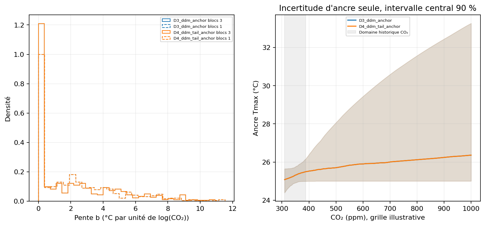

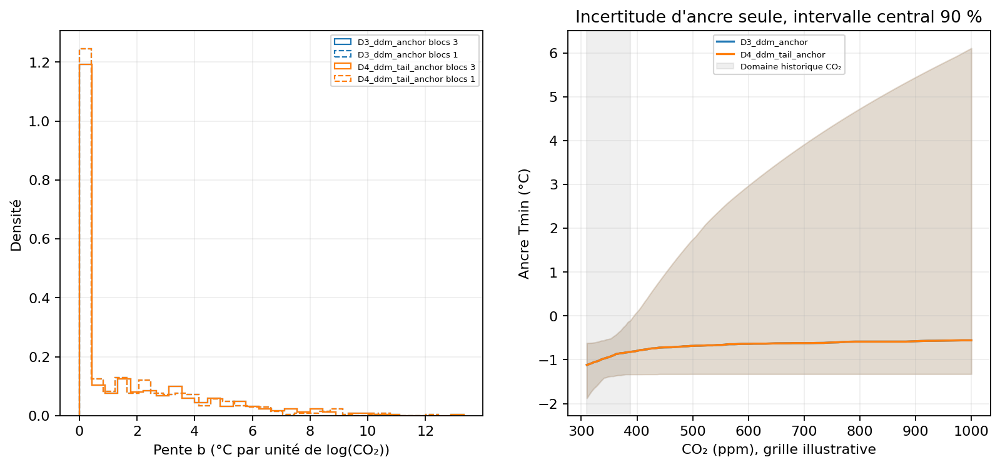

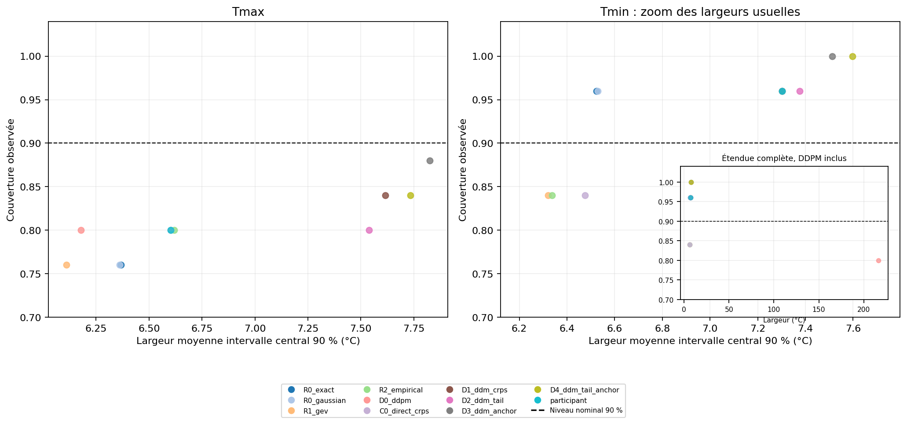

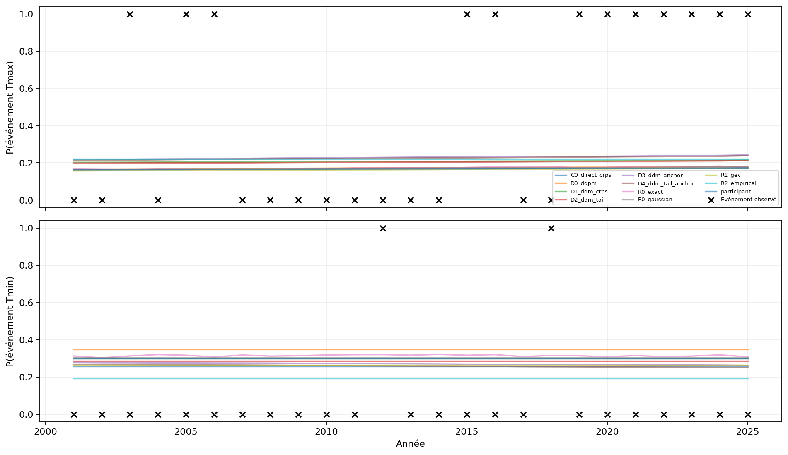

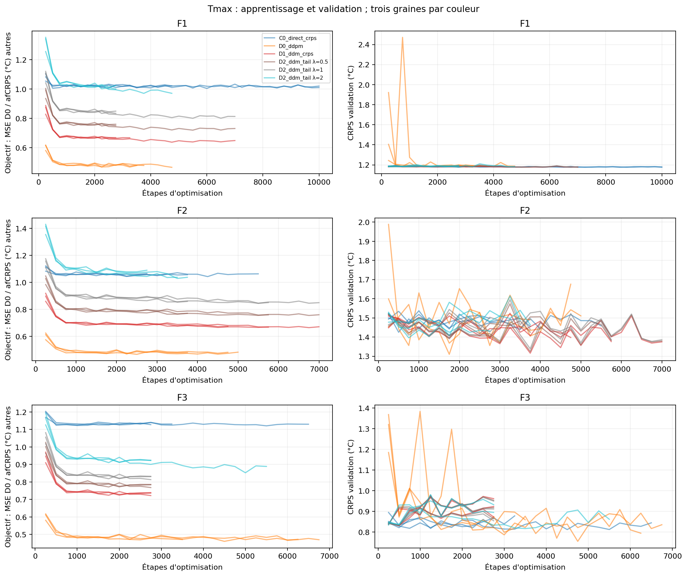

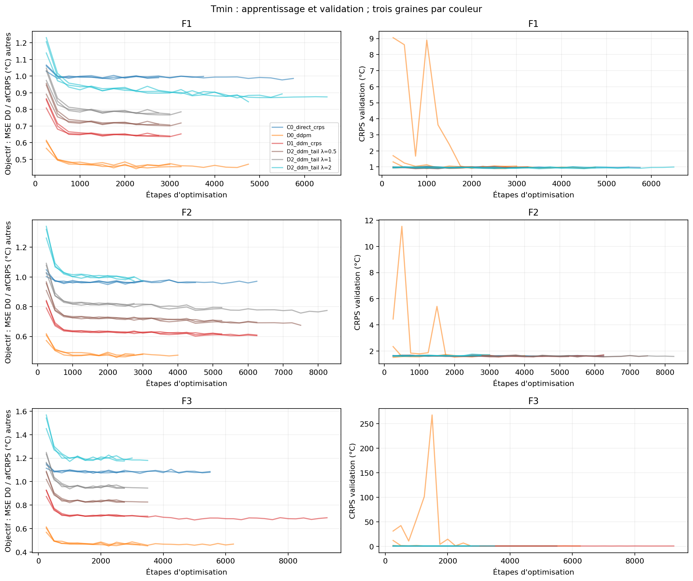

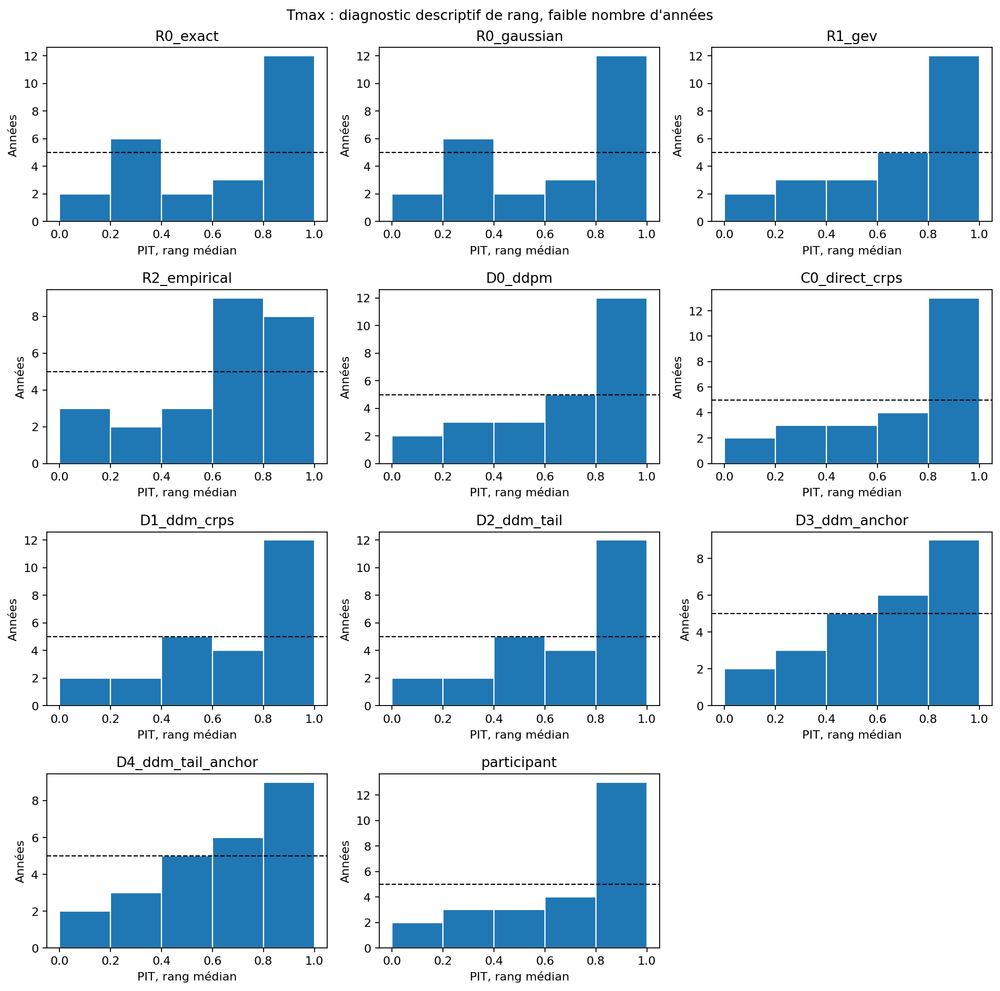

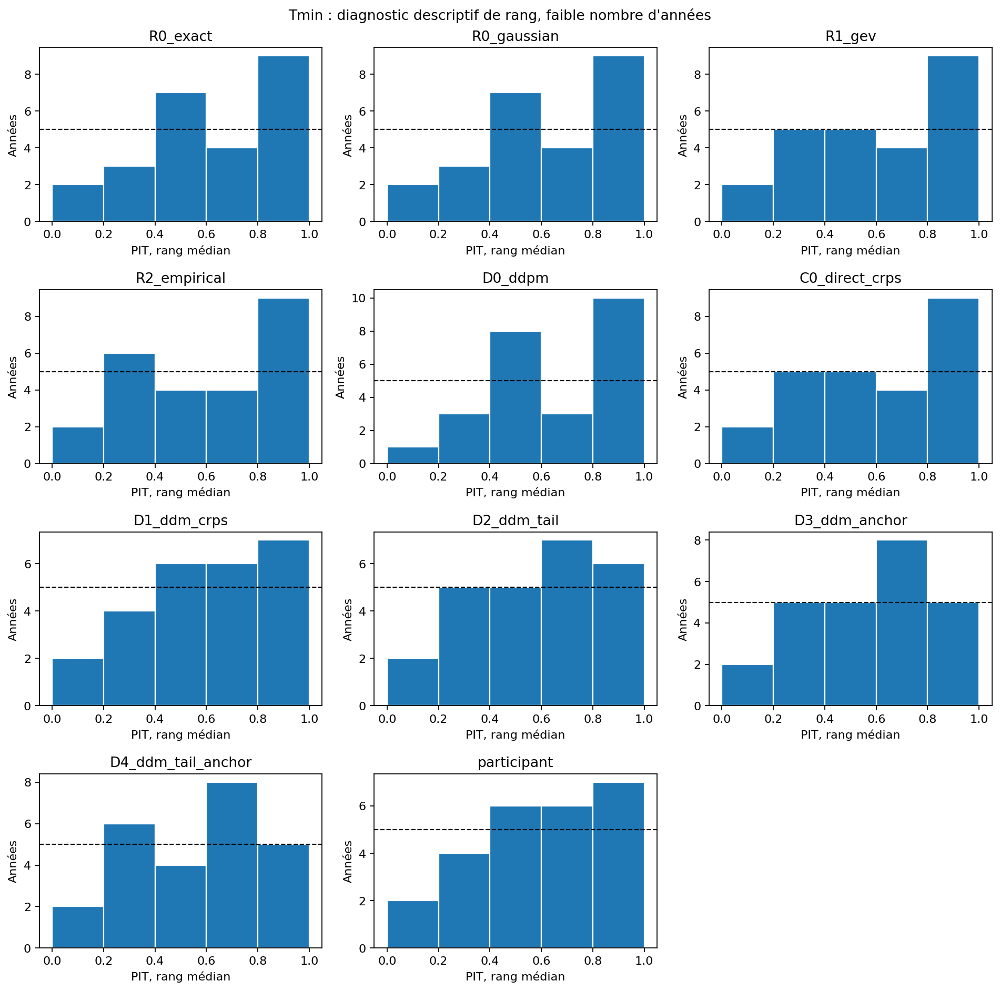

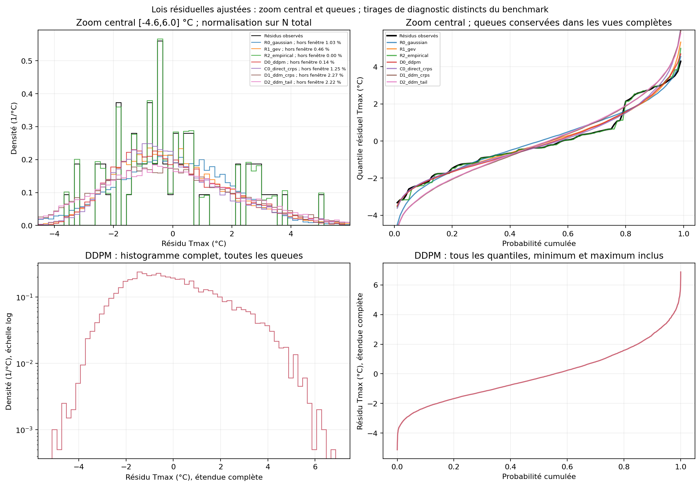

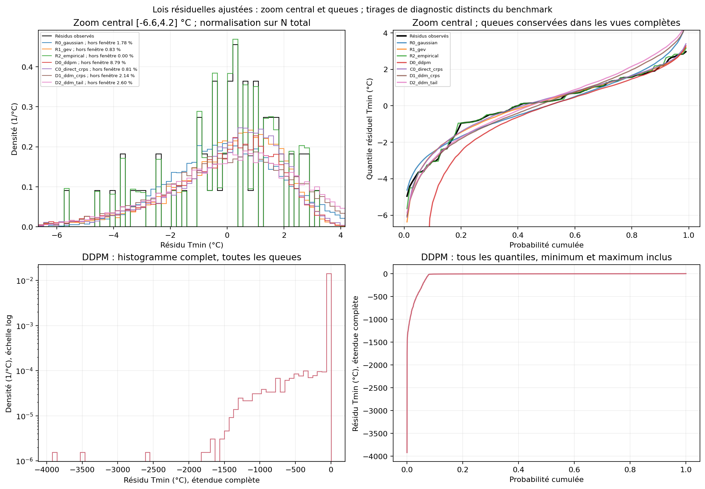

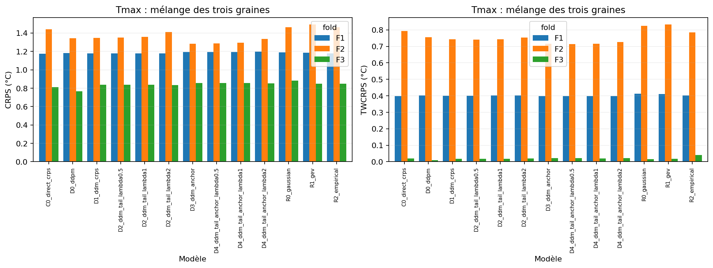

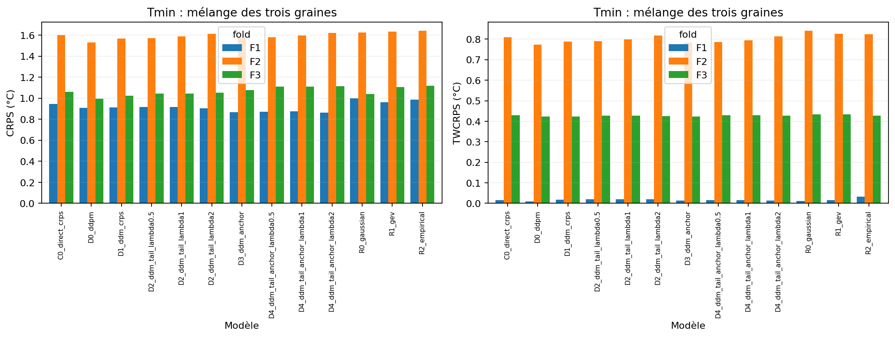

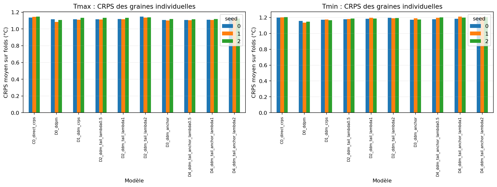


## Références méthodologiques

- [DDPM](https://arxiv.org/abs/2006.11239) et [calendrier cosinus](https://arxiv.org/abs/2102.09672).
- [Diffusion et scores probabilistes météo, prépublication](https://arxiv.org/html/2609.38632v1) ; adaptation scalaire explicitée ci-dessus.
- [AIFS-CRPS](https://arxiv.org/html/2412.15832v1) et [estimateurs CRPS](https://scoringrules.readthedocs.io/en/latest/crps_estimators.html).
- [Scores pondérés](https://scoringrules.readthedocs.io/en/latest/weighted_scores.html).
- [GEV et covariable CO₂](https://ascmo.copernicus.org/articles/9/45/2023/).
- [Validation chronologique](https://otexts.com/fpp3/tscv.html).

Ces références méthodologiques ne fournissent aucune observation supplémentaire au modèle.

La provenance exacte des CSV n'est pas certifiée par leurs métadonnées. La documentation ECMWF
décrit [ERA5 HRES à environ 31 km](https://confluence.ecmwf.int/pages/viewpage.action?navigatingVersions=true&pageId=78296807)
et [ERA5-Land à environ 9 km](https://www.ecmwf.int/en/era5-land). La mention 9 km du starter
ne suffit donc pas à identifier le produit fourni. Les consultations et leurs limites figurent dans `reports/audit_sources.md`.


## Inventaire de traçabilité


- `artifacts/competition/ablation_comparisons.csv`
- `artifacts/competition/annual_analysis/anchor_descriptive.json`
- `artifacts/competition/annual_analysis/annual_correlations.png`
- `artifacts/competition/annual_analysis/annual_correlations.svg`
- `artifacts/competition/annual_analysis/annual_descriptive.csv`
- `artifacts/competition/annual_analysis/annual_observations_anchor.png`
- `artifacts/competition/annual_analysis/annual_observations_anchor.svg`
- `artifacts/competition/annual_analysis/annual_residual_diagnostics.png`
- `artifacts/competition/annual_analysis/annual_residual_diagnostics.svg`
- `artifacts/competition/annual_analysis/annual_summary.json`
- `artifacts/competition/annual_analysis/correlations.csv`
- `artifacts/competition/annual_analysis/residual_descriptive.csv`
- `artifacts/competition/benchmark_results.json`
- `artifacts/competition/benchmark_scores.csv`
- `artifacts/competition/benchmark_stdout/C0_direct_crps.txt`
- `artifacts/competition/benchmark_stdout/D0_ddpm.txt`
- `artifacts/competition/benchmark_stdout/D1_ddm_crps.txt`
- `artifacts/competition/benchmark_stdout/D2_ddm_tail.txt`
- `artifacts/competition/benchmark_stdout/D3_ddm_anchor.txt`
- `artifacts/competition/benchmark_stdout/D4_ddm_tail_anchor.txt`
- `artifacts/competition/benchmark_stdout/R0_exact.txt`
- `artifacts/competition/benchmark_stdout/R0_gaussian.txt`
- `artifacts/competition/benchmark_stdout/R1_gev.txt`
- `artifacts/competition/benchmark_stdout/R2_empirical.txt`
- `artifacts/competition/benchmark_stdout/exemple_original.txt`
- `artifacts/competition/benchmark_stdout/participant.txt`
- `artifacts/competition/bootstrap_block_sensitivity_by_fold.csv`
- `artifacts/competition/bootstrap_block_sensitivity_summary.csv`
- `artifacts/competition/bootstrap_dispersion.csv`
- `artifacts/competition/data_audit.json`
- `artifacts/competition/ddpm_failure_diagnostic.json`
- `artifacts/competition/environment.json`
- `artifacts/competition/evaluation_manifest.json`
- `artifacts/competition/failures.json`
- `artifacts/competition/final/max/C0_direct_crps/fit.json`
- `artifacts/competition/final/max/C0_direct_crps/seed0/best.pt`
- `artifacts/competition/final/max/C0_direct_crps/seed0/history.csv`
- `artifacts/competition/final/max/C0_direct_crps/seed0/last.pt`
- `artifacts/competition/final/max/C0_direct_crps/seed0/metadata.json`
- `artifacts/competition/final/max/C0_direct_crps/seed1/best.pt`
- `artifacts/competition/final/max/C0_direct_crps/seed1/history.csv`
- `artifacts/competition/final/max/C0_direct_crps/seed1/last.pt`
- `artifacts/competition/final/max/C0_direct_crps/seed1/metadata.json`
- `artifacts/competition/final/max/C0_direct_crps/seed2/best.pt`
- `artifacts/competition/final/max/C0_direct_crps/seed2/history.csv`
- `artifacts/competition/final/max/C0_direct_crps/seed2/last.pt`
- `artifacts/competition/final/max/C0_direct_crps/seed2/metadata.json`
- `artifacts/competition/final/max/D0_ddpm/fit.json`
- `artifacts/competition/final/max/D0_ddpm/seed0/best.pt`
- `artifacts/competition/final/max/D0_ddpm/seed0/history.csv`
- `artifacts/competition/final/max/D0_ddpm/seed0/last.pt`
- `artifacts/competition/final/max/D0_ddpm/seed0/metadata.json`
- `artifacts/competition/final/max/D0_ddpm/seed1/best.pt`
- `artifacts/competition/final/max/D0_ddpm/seed1/history.csv`
- `artifacts/competition/final/max/D0_ddpm/seed1/last.pt`
- `artifacts/competition/final/max/D0_ddpm/seed1/metadata.json`
- `artifacts/competition/final/max/D0_ddpm/seed2/best.pt`
- `artifacts/competition/final/max/D0_ddpm/seed2/history.csv`
- `artifacts/competition/final/max/D0_ddpm/seed2/last.pt`
- `artifacts/competition/final/max/D0_ddpm/seed2/metadata.json`
- `artifacts/competition/final/max/D1_ddm_crps/fit.json`
- `artifacts/competition/final/max/D1_ddm_crps/seed0/best.pt`
- `artifacts/competition/final/max/D1_ddm_crps/seed0/history.csv`
- `artifacts/competition/final/max/D1_ddm_crps/seed0/last.pt`
- `artifacts/competition/final/max/D1_ddm_crps/seed0/metadata.json`
- `artifacts/competition/final/max/D1_ddm_crps/seed1/best.pt`
- `artifacts/competition/final/max/D1_ddm_crps/seed1/history.csv`
- `artifacts/competition/final/max/D1_ddm_crps/seed1/last.pt`
- `artifacts/competition/final/max/D1_ddm_crps/seed1/metadata.json`
- `artifacts/competition/final/max/D1_ddm_crps/seed2/best.pt`
- `artifacts/competition/final/max/D1_ddm_crps/seed2/history.csv`
- `artifacts/competition/final/max/D1_ddm_crps/seed2/last.pt`
- `artifacts/competition/final/max/D1_ddm_crps/seed2/metadata.json`
- `artifacts/competition/final/max/D2_ddm_tail/fit.json`
- `artifacts/competition/final/max/D2_ddm_tail/seed0/best.pt`
- `artifacts/competition/final/max/D2_ddm_tail/seed0/history.csv`
- `artifacts/competition/final/max/D2_ddm_tail/seed0/last.pt`
- `artifacts/competition/final/max/D2_ddm_tail/seed0/metadata.json`
- `artifacts/competition/final/max/D2_ddm_tail/seed1/best.pt`
- `artifacts/competition/final/max/D2_ddm_tail/seed1/history.csv`
- `artifacts/competition/final/max/D2_ddm_tail/seed1/last.pt`
- `artifacts/competition/final/max/D2_ddm_tail/seed1/metadata.json`
- `artifacts/competition/final/max/D2_ddm_tail/seed2/best.pt`
- `artifacts/competition/final/max/D2_ddm_tail/seed2/history.csv`
- `artifacts/competition/final/max/D2_ddm_tail/seed2/last.pt`
- `artifacts/competition/final/max/D2_ddm_tail/seed2/metadata.json`
- `artifacts/competition/final/max/D3_ddm_anchor/fit.json`
- `artifacts/competition/final/max/D4_ddm_tail_anchor/fit.json`
- `artifacts/competition/final/max/R0_gaussian/fit.json`
- `artifacts/competition/final/max/R1_gev/fit.json`
- `artifacts/competition/final/max/R2_empirical/fit.json`
- `artifacts/competition/final/min/C0_direct_crps/fit.json`
- `artifacts/competition/final/min/C0_direct_crps/seed0/best.pt`
- `artifacts/competition/final/min/C0_direct_crps/seed0/history.csv`
- `artifacts/competition/final/min/C0_direct_crps/seed0/last.pt`
- `artifacts/competition/final/min/C0_direct_crps/seed0/metadata.json`
- `artifacts/competition/final/min/C0_direct_crps/seed1/best.pt`
- `artifacts/competition/final/min/C0_direct_crps/seed1/history.csv`
- `artifacts/competition/final/min/C0_direct_crps/seed1/last.pt`
- `artifacts/competition/final/min/C0_direct_crps/seed1/metadata.json`
- `artifacts/competition/final/min/C0_direct_crps/seed2/best.pt`
- `artifacts/competition/final/min/C0_direct_crps/seed2/history.csv`
- `artifacts/competition/final/min/C0_direct_crps/seed2/last.pt`
- `artifacts/competition/final/min/C0_direct_crps/seed2/metadata.json`
- `artifacts/competition/final/min/D0_ddpm/fit.json`
- `artifacts/competition/final/min/D0_ddpm/seed0/best.pt`
- `artifacts/competition/final/min/D0_ddpm/seed0/history.csv`
- `artifacts/competition/final/min/D0_ddpm/seed0/last.pt`
- `artifacts/competition/final/min/D0_ddpm/seed0/metadata.json`
- `artifacts/competition/final/min/D0_ddpm/seed1/best.pt`
- `artifacts/competition/final/min/D0_ddpm/seed1/history.csv`
- `artifacts/competition/final/min/D0_ddpm/seed1/last.pt`
- `artifacts/competition/final/min/D0_ddpm/seed1/metadata.json`
- `artifacts/competition/final/min/D0_ddpm/seed2/best.pt`
- `artifacts/competition/final/min/D0_ddpm/seed2/history.csv`
- `artifacts/competition/final/min/D0_ddpm/seed2/last.pt`
- `artifacts/competition/final/min/D0_ddpm/seed2/metadata.json`
- `artifacts/competition/final/min/D1_ddm_crps/fit.json`
- `artifacts/competition/final/min/D1_ddm_crps/seed0/best.pt`
- `artifacts/competition/final/min/D1_ddm_crps/seed0/history.csv`
- `artifacts/competition/final/min/D1_ddm_crps/seed0/last.pt`
- `artifacts/competition/final/min/D1_ddm_crps/seed0/metadata.json`
- `artifacts/competition/final/min/D1_ddm_crps/seed1/best.pt`
- `artifacts/competition/final/min/D1_ddm_crps/seed1/history.csv`
- `artifacts/competition/final/min/D1_ddm_crps/seed1/last.pt`
- `artifacts/competition/final/min/D1_ddm_crps/seed1/metadata.json`
- `artifacts/competition/final/min/D1_ddm_crps/seed2/best.pt`
- `artifacts/competition/final/min/D1_ddm_crps/seed2/history.csv`
- `artifacts/competition/final/min/D1_ddm_crps/seed2/last.pt`
- `artifacts/competition/final/min/D1_ddm_crps/seed2/metadata.json`
- `artifacts/competition/final/min/D2_ddm_tail/fit.json`
- `artifacts/competition/final/min/D2_ddm_tail/seed0/best.pt`
- `artifacts/competition/final/min/D2_ddm_tail/seed0/history.csv`
- `artifacts/competition/final/min/D2_ddm_tail/seed0/last.pt`
- `artifacts/competition/final/min/D2_ddm_tail/seed0/metadata.json`
- `artifacts/competition/final/min/D2_ddm_tail/seed1/best.pt`
- `artifacts/competition/final/min/D2_ddm_tail/seed1/history.csv`
- `artifacts/competition/final/min/D2_ddm_tail/seed1/last.pt`
- `artifacts/competition/final/min/D2_ddm_tail/seed1/metadata.json`
- `artifacts/competition/final/min/D2_ddm_tail/seed2/best.pt`
- `artifacts/competition/final/min/D2_ddm_tail/seed2/history.csv`
- `artifacts/competition/final/min/D2_ddm_tail/seed2/last.pt`
- `artifacts/competition/final/min/D2_ddm_tail/seed2/metadata.json`
- `artifacts/competition/final/min/D3_ddm_anchor/fit.json`
- `artifacts/competition/final/min/D4_ddm_tail_anchor/fit.json`
- `artifacts/competition/final/min/R0_gaussian/fit.json`
- `artifacts/competition/final/min/R1_gev/fit.json`
- `artifacts/competition/final/min/R2_empirical/fit.json`
- `artifacts/competition/fit_final.json`
- `artifacts/competition/fitted_models_summary.csv`
- `artifacts/competition/heatwaves/heatwave_climatology.csv`
- `artifacts/competition/heatwaves/heatwave_counts.png`
- `artifacts/competition/heatwaves/heatwave_counts.svg`
- `artifacts/competition/heatwaves/heatwave_counts_year.csv`
- `artifacts/competition/heatwaves/heatwave_daily_thresholds.csv`
- `artifacts/competition/heatwaves/heatwave_duration_intensity.png`
- `artifacts/competition/heatwaves/heatwave_duration_intensity.svg`
- `artifacts/competition/heatwaves/heatwave_events_min2.csv`
- `artifacts/competition/heatwaves/heatwave_events_min3.csv`
- `artifacts/competition/heatwaves/heatwave_seasonal_cycle.png`
- `artifacts/competition/heatwaves/heatwave_seasonal_cycle.svg`
- `artifacts/competition/heatwaves/heatwave_summary.json`
- `artifacts/competition/locked_source.zip`
- `artifacts/competition/official_descriptive_order.csv`
- `artifacts/competition/prechecks.json`
- `artifacts/competition/prediction_timing.json`
- `artifacts/competition/predictions/C0_direct_crps.npz`
- `artifacts/competition/predictions/D0_ddpm.npz`
- `artifacts/competition/predictions/D1_ddm_crps.npz`
- `artifacts/competition/predictions/D2_ddm_tail.npz`
- `artifacts/competition/predictions/D3_ddm_anchor.npz`
- `artifacts/competition/predictions/D4_ddm_tail_anchor.npz`
- `artifacts/competition/predictions/R0_exact.npz`
- `artifacts/competition/predictions/R0_gaussian.npz`
- `artifacts/competition/predictions/R1_gev.npz`
- `artifacts/competition/predictions/R2_empirical.npz`
- `artifacts/competition/predictions/metadata.json`
- `artifacts/competition/predictions/participant.npz`
- `artifacts/competition/residual_diagnostic_tail_values.csv`
- `artifacts/competition/residual_law_diagnostics.csv`
- `artifacts/competition/run_costs.csv`
- `artifacts/competition/selection.json`
- `artifacts/competition/selection_validation.json`
- `artifacts/competition/test_diagnostics.csv`
- `artifacts/competition/test_per_year.csv`
- `artifacts/competition/test_truth_opened.json`
- `artifacts/competition/validation/fits/max/F1/C0_direct_crps/fit.json`
- `artifacts/competition/validation/fits/max/F1/D0_ddpm/fit.json`
- `artifacts/competition/validation/fits/max/F1/D1_ddm_crps/fit.json`
- `artifacts/competition/validation/fits/max/F1/D2_ddm_tail/fit.json`
- `artifacts/competition/validation/fits/max/F1/D3_ddm_anchor/block1_validation.json`
- `artifacts/competition/validation/fits/max/F1/D3_ddm_anchor/fit.json`
- `artifacts/competition/validation/fits/max/F1/D4_ddm_tail_anchor/fit.json`
- `artifacts/competition/validation/fits/max/F1/D4_ddm_tail_anchor_lambda0.5/block1_validation.json`
- `artifacts/competition/validation/fits/max/F1/D4_ddm_tail_anchor_lambda1/block1_validation.json`
- `artifacts/competition/validation/fits/max/F1/D4_ddm_tail_anchor_lambda2/block1_validation.json`
- `artifacts/competition/validation/fits/max/F1/R0_gaussian/fit.json`
- `artifacts/competition/validation/fits/max/F1/R1_gev/fit.json`
- `artifacts/competition/validation/fits/max/F1/R2_empirical/fit.json`
- `artifacts/competition/validation/fits/max/F2/C0_direct_crps/fit.json`
- `artifacts/competition/validation/fits/max/F2/D0_ddpm/fit.json`
- `artifacts/competition/validation/fits/max/F2/D1_ddm_crps/fit.json`
- `artifacts/competition/validation/fits/max/F2/D2_ddm_tail/fit.json`
- `artifacts/competition/validation/fits/max/F2/D3_ddm_anchor/block1_validation.json`
- `artifacts/competition/validation/fits/max/F2/D3_ddm_anchor/fit.json`
- `artifacts/competition/validation/fits/max/F2/D4_ddm_tail_anchor/fit.json`
- `artifacts/competition/validation/fits/max/F2/D4_ddm_tail_anchor_lambda0.5/block1_validation.json`
- `artifacts/competition/validation/fits/max/F2/D4_ddm_tail_anchor_lambda1/block1_validation.json`
- `artifacts/competition/validation/fits/max/F2/D4_ddm_tail_anchor_lambda2/block1_validation.json`
- `artifacts/competition/validation/fits/max/F2/R0_gaussian/fit.json`
- `artifacts/competition/validation/fits/max/F2/R1_gev/fit.json`
- `artifacts/competition/validation/fits/max/F2/R2_empirical/fit.json`
- `artifacts/competition/validation/fits/max/F3/C0_direct_crps/fit.json`
- `artifacts/competition/validation/fits/max/F3/D0_ddpm/fit.json`
- `artifacts/competition/validation/fits/max/F3/D1_ddm_crps/fit.json`
- `artifacts/competition/validation/fits/max/F3/D2_ddm_tail/fit.json`
- `artifacts/competition/validation/fits/max/F3/D3_ddm_anchor/block1_validation.json`
- `artifacts/competition/validation/fits/max/F3/D3_ddm_anchor/fit.json`
- `artifacts/competition/validation/fits/max/F3/D4_ddm_tail_anchor/fit.json`
- `artifacts/competition/validation/fits/max/F3/D4_ddm_tail_anchor_lambda0.5/block1_validation.json`
- `artifacts/competition/validation/fits/max/F3/D4_ddm_tail_anchor_lambda1/block1_validation.json`
- `artifacts/competition/validation/fits/max/F3/D4_ddm_tail_anchor_lambda2/block1_validation.json`
- `artifacts/competition/validation/fits/max/F3/R0_gaussian/fit.json`
- `artifacts/competition/validation/fits/max/F3/R1_gev/fit.json`
- `artifacts/competition/validation/fits/max/F3/R2_empirical/fit.json`
- `artifacts/competition/validation/fits/min/F1/C0_direct_crps/fit.json`
- `artifacts/competition/validation/fits/min/F1/D0_ddpm/fit.json`
- `artifacts/competition/validation/fits/min/F1/D1_ddm_crps/fit.json`
- `artifacts/competition/validation/fits/min/F1/D2_ddm_tail/fit.json`
- `artifacts/competition/validation/fits/min/F1/D3_ddm_anchor/block1_validation.json`
- `artifacts/competition/validation/fits/min/F1/D3_ddm_anchor/fit.json`
- `artifacts/competition/validation/fits/min/F1/D4_ddm_tail_anchor/fit.json`
- `artifacts/competition/validation/fits/min/F1/D4_ddm_tail_anchor_lambda0.5/block1_validation.json`
- `artifacts/competition/validation/fits/min/F1/D4_ddm_tail_anchor_lambda1/block1_validation.json`
- `artifacts/competition/validation/fits/min/F1/D4_ddm_tail_anchor_lambda2/block1_validation.json`
- `artifacts/competition/validation/fits/min/F1/R0_gaussian/fit.json`
- `artifacts/competition/validation/fits/min/F1/R1_gev/fit.json`
- `artifacts/competition/validation/fits/min/F1/R2_empirical/fit.json`
- `artifacts/competition/validation/fits/min/F2/C0_direct_crps/fit.json`
- `artifacts/competition/validation/fits/min/F2/D0_ddpm/fit.json`
- `artifacts/competition/validation/fits/min/F2/D1_ddm_crps/fit.json`
- `artifacts/competition/validation/fits/min/F2/D2_ddm_tail/fit.json`
- `artifacts/competition/validation/fits/min/F2/D3_ddm_anchor/block1_validation.json`
- `artifacts/competition/validation/fits/min/F2/D3_ddm_anchor/fit.json`
- `artifacts/competition/validation/fits/min/F2/D4_ddm_tail_anchor/fit.json`
- `artifacts/competition/validation/fits/min/F2/D4_ddm_tail_anchor_lambda0.5/block1_validation.json`
- `artifacts/competition/validation/fits/min/F2/D4_ddm_tail_anchor_lambda1/block1_validation.json`
- `artifacts/competition/validation/fits/min/F2/D4_ddm_tail_anchor_lambda2/block1_validation.json`
- `artifacts/competition/validation/fits/min/F2/R0_gaussian/fit.json`
- `artifacts/competition/validation/fits/min/F2/R1_gev/fit.json`
- `artifacts/competition/validation/fits/min/F2/R2_empirical/fit.json`
- `artifacts/competition/validation/fits/min/F3/C0_direct_crps/fit.json`
- `artifacts/competition/validation/fits/min/F3/D0_ddpm/fit.json`
- `artifacts/competition/validation/fits/min/F3/D1_ddm_crps/fit.json`
- `artifacts/competition/validation/fits/min/F3/D2_ddm_tail/fit.json`
- `artifacts/competition/validation/fits/min/F3/D3_ddm_anchor/block1_validation.json`
- `artifacts/competition/validation/fits/min/F3/D3_ddm_anchor/fit.json`
- `artifacts/competition/validation/fits/min/F3/D4_ddm_tail_anchor/fit.json`
- `artifacts/competition/validation/fits/min/F3/D4_ddm_tail_anchor_lambda0.5/block1_validation.json`
- `artifacts/competition/validation/fits/min/F3/D4_ddm_tail_anchor_lambda1/block1_validation.json`
- `artifacts/competition/validation/fits/min/F3/D4_ddm_tail_anchor_lambda2/block1_validation.json`
- `artifacts/competition/validation/fits/min/F3/R0_gaussian/fit.json`
- `artifacts/competition/validation/fits/min/F3/R1_gev/fit.json`
- `artifacts/competition/validation/fits/min/F3/R2_empirical/fit.json`
- `artifacts/competition/validation/runs/max/F1/C0_direct_crps/seed0/best.pt`
- `artifacts/competition/validation/runs/max/F1/C0_direct_crps/seed0/history.csv`
- `artifacts/competition/validation/runs/max/F1/C0_direct_crps/seed0/last.pt`
- `artifacts/competition/validation/runs/max/F1/C0_direct_crps/seed0/metadata.json`
- `artifacts/competition/validation/runs/max/F1/C0_direct_crps/seed1/best.pt`
- `artifacts/competition/validation/runs/max/F1/C0_direct_crps/seed1/history.csv`
- `artifacts/competition/validation/runs/max/F1/C0_direct_crps/seed1/last.pt`
- `artifacts/competition/validation/runs/max/F1/C0_direct_crps/seed1/metadata.json`
- `artifacts/competition/validation/runs/max/F1/C0_direct_crps/seed2/best.pt`
- `artifacts/competition/validation/runs/max/F1/C0_direct_crps/seed2/history.csv`
- `artifacts/competition/validation/runs/max/F1/C0_direct_crps/seed2/last.pt`
- `artifacts/competition/validation/runs/max/F1/C0_direct_crps/seed2/metadata.json`
- `artifacts/competition/validation/runs/max/F1/D0_ddpm/seed0/best.pt`
- `artifacts/competition/validation/runs/max/F1/D0_ddpm/seed0/history.csv`
- `artifacts/competition/validation/runs/max/F1/D0_ddpm/seed0/last.pt`
- `artifacts/competition/validation/runs/max/F1/D0_ddpm/seed0/metadata.json`
- `artifacts/competition/validation/runs/max/F1/D0_ddpm/seed1/best.pt`
- `artifacts/competition/validation/runs/max/F1/D0_ddpm/seed1/history.csv`
- `artifacts/competition/validation/runs/max/F1/D0_ddpm/seed1/last.pt`
- `artifacts/competition/validation/runs/max/F1/D0_ddpm/seed1/metadata.json`
- `artifacts/competition/validation/runs/max/F1/D0_ddpm/seed2/best.pt`
- `artifacts/competition/validation/runs/max/F1/D0_ddpm/seed2/history.csv`
- `artifacts/competition/validation/runs/max/F1/D0_ddpm/seed2/last.pt`
- `artifacts/competition/validation/runs/max/F1/D0_ddpm/seed2/metadata.json`
- `artifacts/competition/validation/runs/max/F1/D1_ddm_crps/seed0/best.pt`
- `artifacts/competition/validation/runs/max/F1/D1_ddm_crps/seed0/history.csv`
- `artifacts/competition/validation/runs/max/F1/D1_ddm_crps/seed0/last.pt`
- `artifacts/competition/validation/runs/max/F1/D1_ddm_crps/seed0/metadata.json`
- `artifacts/competition/validation/runs/max/F1/D1_ddm_crps/seed1/best.pt`
- `artifacts/competition/validation/runs/max/F1/D1_ddm_crps/seed1/history.csv`
- `artifacts/competition/validation/runs/max/F1/D1_ddm_crps/seed1/last.pt`
- `artifacts/competition/validation/runs/max/F1/D1_ddm_crps/seed1/metadata.json`
- `artifacts/competition/validation/runs/max/F1/D1_ddm_crps/seed2/best.pt`
- `artifacts/competition/validation/runs/max/F1/D1_ddm_crps/seed2/history.csv`
- `artifacts/competition/validation/runs/max/F1/D1_ddm_crps/seed2/last.pt`
- `artifacts/competition/validation/runs/max/F1/D1_ddm_crps/seed2/metadata.json`
- `artifacts/competition/validation/runs/max/F1/D2_ddm_tail_lambda0.5/seed0/best.pt`
- `artifacts/competition/validation/runs/max/F1/D2_ddm_tail_lambda0.5/seed0/history.csv`
- `artifacts/competition/validation/runs/max/F1/D2_ddm_tail_lambda0.5/seed0/last.pt`
- `artifacts/competition/validation/runs/max/F1/D2_ddm_tail_lambda0.5/seed0/metadata.json`
- `artifacts/competition/validation/runs/max/F1/D2_ddm_tail_lambda0.5/seed1/best.pt`
- `artifacts/competition/validation/runs/max/F1/D2_ddm_tail_lambda0.5/seed1/history.csv`
- `artifacts/competition/validation/runs/max/F1/D2_ddm_tail_lambda0.5/seed1/last.pt`
- `artifacts/competition/validation/runs/max/F1/D2_ddm_tail_lambda0.5/seed1/metadata.json`
- `artifacts/competition/validation/runs/max/F1/D2_ddm_tail_lambda0.5/seed2/best.pt`
- `artifacts/competition/validation/runs/max/F1/D2_ddm_tail_lambda0.5/seed2/history.csv`
- `artifacts/competition/validation/runs/max/F1/D2_ddm_tail_lambda0.5/seed2/last.pt`
- `artifacts/competition/validation/runs/max/F1/D2_ddm_tail_lambda0.5/seed2/metadata.json`
- `artifacts/competition/validation/runs/max/F1/D2_ddm_tail_lambda1/seed0/best.pt`
- `artifacts/competition/validation/runs/max/F1/D2_ddm_tail_lambda1/seed0/history.csv`
- `artifacts/competition/validation/runs/max/F1/D2_ddm_tail_lambda1/seed0/last.pt`
- `artifacts/competition/validation/runs/max/F1/D2_ddm_tail_lambda1/seed0/metadata.json`
- `artifacts/competition/validation/runs/max/F1/D2_ddm_tail_lambda1/seed1/best.pt`
- `artifacts/competition/validation/runs/max/F1/D2_ddm_tail_lambda1/seed1/history.csv`
- `artifacts/competition/validation/runs/max/F1/D2_ddm_tail_lambda1/seed1/last.pt`
- `artifacts/competition/validation/runs/max/F1/D2_ddm_tail_lambda1/seed1/metadata.json`
- `artifacts/competition/validation/runs/max/F1/D2_ddm_tail_lambda1/seed2/best.pt`
- `artifacts/competition/validation/runs/max/F1/D2_ddm_tail_lambda1/seed2/history.csv`
- `artifacts/competition/validation/runs/max/F1/D2_ddm_tail_lambda1/seed2/last.pt`
- `artifacts/competition/validation/runs/max/F1/D2_ddm_tail_lambda1/seed2/metadata.json`
- `artifacts/competition/validation/runs/max/F1/D2_ddm_tail_lambda2/seed0/best.pt`
- `artifacts/competition/validation/runs/max/F1/D2_ddm_tail_lambda2/seed0/history.csv`
- `artifacts/competition/validation/runs/max/F1/D2_ddm_tail_lambda2/seed0/last.pt`
- `artifacts/competition/validation/runs/max/F1/D2_ddm_tail_lambda2/seed0/metadata.json`
- `artifacts/competition/validation/runs/max/F1/D2_ddm_tail_lambda2/seed1/best.pt`
- `artifacts/competition/validation/runs/max/F1/D2_ddm_tail_lambda2/seed1/history.csv`
- `artifacts/competition/validation/runs/max/F1/D2_ddm_tail_lambda2/seed1/last.pt`
- `artifacts/competition/validation/runs/max/F1/D2_ddm_tail_lambda2/seed1/metadata.json`
- `artifacts/competition/validation/runs/max/F1/D2_ddm_tail_lambda2/seed2/best.pt`
- `artifacts/competition/validation/runs/max/F1/D2_ddm_tail_lambda2/seed2/history.csv`
- `artifacts/competition/validation/runs/max/F1/D2_ddm_tail_lambda2/seed2/last.pt`
- `artifacts/competition/validation/runs/max/F1/D2_ddm_tail_lambda2/seed2/metadata.json`
- `artifacts/competition/validation/runs/max/F2/C0_direct_crps/seed0/best.pt`
- `artifacts/competition/validation/runs/max/F2/C0_direct_crps/seed0/history.csv`
- `artifacts/competition/validation/runs/max/F2/C0_direct_crps/seed0/last.pt`
- `artifacts/competition/validation/runs/max/F2/C0_direct_crps/seed0/metadata.json`
- `artifacts/competition/validation/runs/max/F2/C0_direct_crps/seed1/best.pt`
- `artifacts/competition/validation/runs/max/F2/C0_direct_crps/seed1/history.csv`
- `artifacts/competition/validation/runs/max/F2/C0_direct_crps/seed1/last.pt`
- `artifacts/competition/validation/runs/max/F2/C0_direct_crps/seed1/metadata.json`
- `artifacts/competition/validation/runs/max/F2/C0_direct_crps/seed2/best.pt`
- `artifacts/competition/validation/runs/max/F2/C0_direct_crps/seed2/history.csv`
- `artifacts/competition/validation/runs/max/F2/C0_direct_crps/seed2/last.pt`
- `artifacts/competition/validation/runs/max/F2/C0_direct_crps/seed2/metadata.json`
- `artifacts/competition/validation/runs/max/F2/D0_ddpm/seed0/best.pt`
- `artifacts/competition/validation/runs/max/F2/D0_ddpm/seed0/history.csv`
- `artifacts/competition/validation/runs/max/F2/D0_ddpm/seed0/last.pt`
- `artifacts/competition/validation/runs/max/F2/D0_ddpm/seed0/metadata.json`
- `artifacts/competition/validation/runs/max/F2/D0_ddpm/seed1/best.pt`
- `artifacts/competition/validation/runs/max/F2/D0_ddpm/seed1/history.csv`
- `artifacts/competition/validation/runs/max/F2/D0_ddpm/seed1/last.pt`
- `artifacts/competition/validation/runs/max/F2/D0_ddpm/seed1/metadata.json`
- `artifacts/competition/validation/runs/max/F2/D0_ddpm/seed2/best.pt`
- `artifacts/competition/validation/runs/max/F2/D0_ddpm/seed2/history.csv`
- `artifacts/competition/validation/runs/max/F2/D0_ddpm/seed2/last.pt`
- `artifacts/competition/validation/runs/max/F2/D0_ddpm/seed2/metadata.json`
- `artifacts/competition/validation/runs/max/F2/D1_ddm_crps/seed0/best.pt`
- `artifacts/competition/validation/runs/max/F2/D1_ddm_crps/seed0/history.csv`
- `artifacts/competition/validation/runs/max/F2/D1_ddm_crps/seed0/last.pt`
- `artifacts/competition/validation/runs/max/F2/D1_ddm_crps/seed0/metadata.json`
- `artifacts/competition/validation/runs/max/F2/D1_ddm_crps/seed1/best.pt`
- `artifacts/competition/validation/runs/max/F2/D1_ddm_crps/seed1/history.csv`
- `artifacts/competition/validation/runs/max/F2/D1_ddm_crps/seed1/last.pt`
- `artifacts/competition/validation/runs/max/F2/D1_ddm_crps/seed1/metadata.json`
- `artifacts/competition/validation/runs/max/F2/D1_ddm_crps/seed2/best.pt`
- `artifacts/competition/validation/runs/max/F2/D1_ddm_crps/seed2/history.csv`
- `artifacts/competition/validation/runs/max/F2/D1_ddm_crps/seed2/last.pt`
- `artifacts/competition/validation/runs/max/F2/D1_ddm_crps/seed2/metadata.json`
- `artifacts/competition/validation/runs/max/F2/D2_ddm_tail_lambda0.5/seed0/best.pt`
- `artifacts/competition/validation/runs/max/F2/D2_ddm_tail_lambda0.5/seed0/history.csv`
- `artifacts/competition/validation/runs/max/F2/D2_ddm_tail_lambda0.5/seed0/last.pt`
- `artifacts/competition/validation/runs/max/F2/D2_ddm_tail_lambda0.5/seed0/metadata.json`
- `artifacts/competition/validation/runs/max/F2/D2_ddm_tail_lambda0.5/seed1/best.pt`
- `artifacts/competition/validation/runs/max/F2/D2_ddm_tail_lambda0.5/seed1/history.csv`
- `artifacts/competition/validation/runs/max/F2/D2_ddm_tail_lambda0.5/seed1/last.pt`
- `artifacts/competition/validation/runs/max/F2/D2_ddm_tail_lambda0.5/seed1/metadata.json`
- `artifacts/competition/validation/runs/max/F2/D2_ddm_tail_lambda0.5/seed2/best.pt`
- `artifacts/competition/validation/runs/max/F2/D2_ddm_tail_lambda0.5/seed2/history.csv`
- `artifacts/competition/validation/runs/max/F2/D2_ddm_tail_lambda0.5/seed2/last.pt`
- `artifacts/competition/validation/runs/max/F2/D2_ddm_tail_lambda0.5/seed2/metadata.json`
- `artifacts/competition/validation/runs/max/F2/D2_ddm_tail_lambda1/seed0/best.pt`
- `artifacts/competition/validation/runs/max/F2/D2_ddm_tail_lambda1/seed0/history.csv`
- `artifacts/competition/validation/runs/max/F2/D2_ddm_tail_lambda1/seed0/last.pt`
- `artifacts/competition/validation/runs/max/F2/D2_ddm_tail_lambda1/seed0/metadata.json`
- `artifacts/competition/validation/runs/max/F2/D2_ddm_tail_lambda1/seed1/best.pt`
- `artifacts/competition/validation/runs/max/F2/D2_ddm_tail_lambda1/seed1/history.csv`
- `artifacts/competition/validation/runs/max/F2/D2_ddm_tail_lambda1/seed1/last.pt`
- `artifacts/competition/validation/runs/max/F2/D2_ddm_tail_lambda1/seed1/metadata.json`
- `artifacts/competition/validation/runs/max/F2/D2_ddm_tail_lambda1/seed2/best.pt`
- `artifacts/competition/validation/runs/max/F2/D2_ddm_tail_lambda1/seed2/history.csv`
- `artifacts/competition/validation/runs/max/F2/D2_ddm_tail_lambda1/seed2/last.pt`
- `artifacts/competition/validation/runs/max/F2/D2_ddm_tail_lambda1/seed2/metadata.json`
- `artifacts/competition/validation/runs/max/F2/D2_ddm_tail_lambda2/seed0/best.pt`
- `artifacts/competition/validation/runs/max/F2/D2_ddm_tail_lambda2/seed0/history.csv`
- `artifacts/competition/validation/runs/max/F2/D2_ddm_tail_lambda2/seed0/last.pt`
- `artifacts/competition/validation/runs/max/F2/D2_ddm_tail_lambda2/seed0/metadata.json`
- `artifacts/competition/validation/runs/max/F2/D2_ddm_tail_lambda2/seed1/best.pt`
- `artifacts/competition/validation/runs/max/F2/D2_ddm_tail_lambda2/seed1/history.csv`
- `artifacts/competition/validation/runs/max/F2/D2_ddm_tail_lambda2/seed1/last.pt`
- `artifacts/competition/validation/runs/max/F2/D2_ddm_tail_lambda2/seed1/metadata.json`
- `artifacts/competition/validation/runs/max/F2/D2_ddm_tail_lambda2/seed2/best.pt`
- `artifacts/competition/validation/runs/max/F2/D2_ddm_tail_lambda2/seed2/history.csv`
- `artifacts/competition/validation/runs/max/F2/D2_ddm_tail_lambda2/seed2/last.pt`
- `artifacts/competition/validation/runs/max/F2/D2_ddm_tail_lambda2/seed2/metadata.json`
- `artifacts/competition/validation/runs/max/F3/C0_direct_crps/seed0/best.pt`
- `artifacts/competition/validation/runs/max/F3/C0_direct_crps/seed0/history.csv`
- `artifacts/competition/validation/runs/max/F3/C0_direct_crps/seed0/last.pt`
- `artifacts/competition/validation/runs/max/F3/C0_direct_crps/seed0/metadata.json`
- `artifacts/competition/validation/runs/max/F3/C0_direct_crps/seed1/best.pt`
- `artifacts/competition/validation/runs/max/F3/C0_direct_crps/seed1/history.csv`
- `artifacts/competition/validation/runs/max/F3/C0_direct_crps/seed1/last.pt`
- `artifacts/competition/validation/runs/max/F3/C0_direct_crps/seed1/metadata.json`
- `artifacts/competition/validation/runs/max/F3/C0_direct_crps/seed2/best.pt`
- `artifacts/competition/validation/runs/max/F3/C0_direct_crps/seed2/history.csv`
- `artifacts/competition/validation/runs/max/F3/C0_direct_crps/seed2/last.pt`
- `artifacts/competition/validation/runs/max/F3/C0_direct_crps/seed2/metadata.json`
- `artifacts/competition/validation/runs/max/F3/D0_ddpm/seed0/best.pt`
- `artifacts/competition/validation/runs/max/F3/D0_ddpm/seed0/history.csv`
- `artifacts/competition/validation/runs/max/F3/D0_ddpm/seed0/last.pt`
- `artifacts/competition/validation/runs/max/F3/D0_ddpm/seed0/metadata.json`
- `artifacts/competition/validation/runs/max/F3/D0_ddpm/seed1/best.pt`
- `artifacts/competition/validation/runs/max/F3/D0_ddpm/seed1/history.csv`
- `artifacts/competition/validation/runs/max/F3/D0_ddpm/seed1/last.pt`
- `artifacts/competition/validation/runs/max/F3/D0_ddpm/seed1/metadata.json`
- `artifacts/competition/validation/runs/max/F3/D0_ddpm/seed2/best.pt`
- `artifacts/competition/validation/runs/max/F3/D0_ddpm/seed2/history.csv`
- `artifacts/competition/validation/runs/max/F3/D0_ddpm/seed2/last.pt`
- `artifacts/competition/validation/runs/max/F3/D0_ddpm/seed2/metadata.json`
- `artifacts/competition/validation/runs/max/F3/D1_ddm_crps/seed0/best.pt`
- `artifacts/competition/validation/runs/max/F3/D1_ddm_crps/seed0/history.csv`
- `artifacts/competition/validation/runs/max/F3/D1_ddm_crps/seed0/last.pt`
- `artifacts/competition/validation/runs/max/F3/D1_ddm_crps/seed0/metadata.json`
- `artifacts/competition/validation/runs/max/F3/D1_ddm_crps/seed1/best.pt`
- `artifacts/competition/validation/runs/max/F3/D1_ddm_crps/seed1/history.csv`
- `artifacts/competition/validation/runs/max/F3/D1_ddm_crps/seed1/last.pt`
- `artifacts/competition/validation/runs/max/F3/D1_ddm_crps/seed1/metadata.json`
- `artifacts/competition/validation/runs/max/F3/D1_ddm_crps/seed2/best.pt`
- `artifacts/competition/validation/runs/max/F3/D1_ddm_crps/seed2/history.csv`
- `artifacts/competition/validation/runs/max/F3/D1_ddm_crps/seed2/last.pt`
- `artifacts/competition/validation/runs/max/F3/D1_ddm_crps/seed2/metadata.json`
- `artifacts/competition/validation/runs/max/F3/D2_ddm_tail_lambda0.5/seed0/best.pt`
- `artifacts/competition/validation/runs/max/F3/D2_ddm_tail_lambda0.5/seed0/history.csv`
- `artifacts/competition/validation/runs/max/F3/D2_ddm_tail_lambda0.5/seed0/last.pt`
- `artifacts/competition/validation/runs/max/F3/D2_ddm_tail_lambda0.5/seed0/metadata.json`
- `artifacts/competition/validation/runs/max/F3/D2_ddm_tail_lambda0.5/seed1/best.pt`
- `artifacts/competition/validation/runs/max/F3/D2_ddm_tail_lambda0.5/seed1/history.csv`
- `artifacts/competition/validation/runs/max/F3/D2_ddm_tail_lambda0.5/seed1/last.pt`
- `artifacts/competition/validation/runs/max/F3/D2_ddm_tail_lambda0.5/seed1/metadata.json`
- `artifacts/competition/validation/runs/max/F3/D2_ddm_tail_lambda0.5/seed2/best.pt`
- `artifacts/competition/validation/runs/max/F3/D2_ddm_tail_lambda0.5/seed2/history.csv`
- `artifacts/competition/validation/runs/max/F3/D2_ddm_tail_lambda0.5/seed2/last.pt`
- `artifacts/competition/validation/runs/max/F3/D2_ddm_tail_lambda0.5/seed2/metadata.json`
- `artifacts/competition/validation/runs/max/F3/D2_ddm_tail_lambda1/seed0/best.pt`
- `artifacts/competition/validation/runs/max/F3/D2_ddm_tail_lambda1/seed0/history.csv`
- `artifacts/competition/validation/runs/max/F3/D2_ddm_tail_lambda1/seed0/last.pt`
- `artifacts/competition/validation/runs/max/F3/D2_ddm_tail_lambda1/seed0/metadata.json`
- `artifacts/competition/validation/runs/max/F3/D2_ddm_tail_lambda1/seed1/best.pt`
- `artifacts/competition/validation/runs/max/F3/D2_ddm_tail_lambda1/seed1/history.csv`
- `artifacts/competition/validation/runs/max/F3/D2_ddm_tail_lambda1/seed1/last.pt`
- `artifacts/competition/validation/runs/max/F3/D2_ddm_tail_lambda1/seed1/metadata.json`
- `artifacts/competition/validation/runs/max/F3/D2_ddm_tail_lambda1/seed2/best.pt`
- `artifacts/competition/validation/runs/max/F3/D2_ddm_tail_lambda1/seed2/history.csv`
- `artifacts/competition/validation/runs/max/F3/D2_ddm_tail_lambda1/seed2/last.pt`
- `artifacts/competition/validation/runs/max/F3/D2_ddm_tail_lambda1/seed2/metadata.json`
- `artifacts/competition/validation/runs/max/F3/D2_ddm_tail_lambda2/seed0/best.pt`
- `artifacts/competition/validation/runs/max/F3/D2_ddm_tail_lambda2/seed0/history.csv`
- `artifacts/competition/validation/runs/max/F3/D2_ddm_tail_lambda2/seed0/last.pt`
- `artifacts/competition/validation/runs/max/F3/D2_ddm_tail_lambda2/seed0/metadata.json`
- `artifacts/competition/validation/runs/max/F3/D2_ddm_tail_lambda2/seed1/best.pt`
- `artifacts/competition/validation/runs/max/F3/D2_ddm_tail_lambda2/seed1/history.csv`
- `artifacts/competition/validation/runs/max/F3/D2_ddm_tail_lambda2/seed1/last.pt`
- `artifacts/competition/validation/runs/max/F3/D2_ddm_tail_lambda2/seed1/metadata.json`
- `artifacts/competition/validation/runs/max/F3/D2_ddm_tail_lambda2/seed2/best.pt`
- `artifacts/competition/validation/runs/max/F3/D2_ddm_tail_lambda2/seed2/history.csv`
- `artifacts/competition/validation/runs/max/F3/D2_ddm_tail_lambda2/seed2/last.pt`
- `artifacts/competition/validation/runs/max/F3/D2_ddm_tail_lambda2/seed2/metadata.json`
- `artifacts/competition/validation/runs/min/F1/C0_direct_crps/seed0/best.pt`
- `artifacts/competition/validation/runs/min/F1/C0_direct_crps/seed0/history.csv`
- `artifacts/competition/validation/runs/min/F1/C0_direct_crps/seed0/last.pt`
- `artifacts/competition/validation/runs/min/F1/C0_direct_crps/seed0/metadata.json`
- `artifacts/competition/validation/runs/min/F1/C0_direct_crps/seed1/best.pt`
- `artifacts/competition/validation/runs/min/F1/C0_direct_crps/seed1/history.csv`
- `artifacts/competition/validation/runs/min/F1/C0_direct_crps/seed1/last.pt`
- `artifacts/competition/validation/runs/min/F1/C0_direct_crps/seed1/metadata.json`
- `artifacts/competition/validation/runs/min/F1/C0_direct_crps/seed2/best.pt`
- `artifacts/competition/validation/runs/min/F1/C0_direct_crps/seed2/history.csv`
- `artifacts/competition/validation/runs/min/F1/C0_direct_crps/seed2/last.pt`
- `artifacts/competition/validation/runs/min/F1/C0_direct_crps/seed2/metadata.json`
- `artifacts/competition/validation/runs/min/F1/D0_ddpm/seed0/best.pt`
- `artifacts/competition/validation/runs/min/F1/D0_ddpm/seed0/history.csv`
- `artifacts/competition/validation/runs/min/F1/D0_ddpm/seed0/last.pt`
- `artifacts/competition/validation/runs/min/F1/D0_ddpm/seed0/metadata.json`
- `artifacts/competition/validation/runs/min/F1/D0_ddpm/seed1/best.pt`
- `artifacts/competition/validation/runs/min/F1/D0_ddpm/seed1/history.csv`
- `artifacts/competition/validation/runs/min/F1/D0_ddpm/seed1/last.pt`
- `artifacts/competition/validation/runs/min/F1/D0_ddpm/seed1/metadata.json`
- `artifacts/competition/validation/runs/min/F1/D0_ddpm/seed2/best.pt`
- `artifacts/competition/validation/runs/min/F1/D0_ddpm/seed2/history.csv`
- `artifacts/competition/validation/runs/min/F1/D0_ddpm/seed2/last.pt`
- `artifacts/competition/validation/runs/min/F1/D0_ddpm/seed2/metadata.json`
- `artifacts/competition/validation/runs/min/F1/D1_ddm_crps/seed0/best.pt`
- `artifacts/competition/validation/runs/min/F1/D1_ddm_crps/seed0/history.csv`
- `artifacts/competition/validation/runs/min/F1/D1_ddm_crps/seed0/last.pt`
- `artifacts/competition/validation/runs/min/F1/D1_ddm_crps/seed0/metadata.json`
- `artifacts/competition/validation/runs/min/F1/D1_ddm_crps/seed1/best.pt`
- `artifacts/competition/validation/runs/min/F1/D1_ddm_crps/seed1/history.csv`
- `artifacts/competition/validation/runs/min/F1/D1_ddm_crps/seed1/last.pt`
- `artifacts/competition/validation/runs/min/F1/D1_ddm_crps/seed1/metadata.json`
- `artifacts/competition/validation/runs/min/F1/D1_ddm_crps/seed2/best.pt`
- `artifacts/competition/validation/runs/min/F1/D1_ddm_crps/seed2/history.csv`
- `artifacts/competition/validation/runs/min/F1/D1_ddm_crps/seed2/last.pt`
- `artifacts/competition/validation/runs/min/F1/D1_ddm_crps/seed2/metadata.json`
- `artifacts/competition/validation/runs/min/F1/D2_ddm_tail_lambda0.5/seed0/best.pt`
- `artifacts/competition/validation/runs/min/F1/D2_ddm_tail_lambda0.5/seed0/history.csv`
- `artifacts/competition/validation/runs/min/F1/D2_ddm_tail_lambda0.5/seed0/last.pt`
- `artifacts/competition/validation/runs/min/F1/D2_ddm_tail_lambda0.5/seed0/metadata.json`
- `artifacts/competition/validation/runs/min/F1/D2_ddm_tail_lambda0.5/seed1/best.pt`
- `artifacts/competition/validation/runs/min/F1/D2_ddm_tail_lambda0.5/seed1/history.csv`
- `artifacts/competition/validation/runs/min/F1/D2_ddm_tail_lambda0.5/seed1/last.pt`
- `artifacts/competition/validation/runs/min/F1/D2_ddm_tail_lambda0.5/seed1/metadata.json`
- `artifacts/competition/validation/runs/min/F1/D2_ddm_tail_lambda0.5/seed2/best.pt`
- `artifacts/competition/validation/runs/min/F1/D2_ddm_tail_lambda0.5/seed2/history.csv`
- `artifacts/competition/validation/runs/min/F1/D2_ddm_tail_lambda0.5/seed2/last.pt`
- `artifacts/competition/validation/runs/min/F1/D2_ddm_tail_lambda0.5/seed2/metadata.json`
- `artifacts/competition/validation/runs/min/F1/D2_ddm_tail_lambda1/seed0/best.pt`
- `artifacts/competition/validation/runs/min/F1/D2_ddm_tail_lambda1/seed0/history.csv`
- `artifacts/competition/validation/runs/min/F1/D2_ddm_tail_lambda1/seed0/last.pt`
- `artifacts/competition/validation/runs/min/F1/D2_ddm_tail_lambda1/seed0/metadata.json`
- `artifacts/competition/validation/runs/min/F1/D2_ddm_tail_lambda1/seed1/best.pt`
- `artifacts/competition/validation/runs/min/F1/D2_ddm_tail_lambda1/seed1/history.csv`
- `artifacts/competition/validation/runs/min/F1/D2_ddm_tail_lambda1/seed1/last.pt`
- `artifacts/competition/validation/runs/min/F1/D2_ddm_tail_lambda1/seed1/metadata.json`
- `artifacts/competition/validation/runs/min/F1/D2_ddm_tail_lambda1/seed2/best.pt`
- `artifacts/competition/validation/runs/min/F1/D2_ddm_tail_lambda1/seed2/history.csv`
- `artifacts/competition/validation/runs/min/F1/D2_ddm_tail_lambda1/seed2/last.pt`
- `artifacts/competition/validation/runs/min/F1/D2_ddm_tail_lambda1/seed2/metadata.json`
- `artifacts/competition/validation/runs/min/F1/D2_ddm_tail_lambda2/seed0/best.pt`
- `artifacts/competition/validation/runs/min/F1/D2_ddm_tail_lambda2/seed0/history.csv`
- `artifacts/competition/validation/runs/min/F1/D2_ddm_tail_lambda2/seed0/last.pt`
- `artifacts/competition/validation/runs/min/F1/D2_ddm_tail_lambda2/seed0/metadata.json`
- `artifacts/competition/validation/runs/min/F1/D2_ddm_tail_lambda2/seed1/best.pt`
- `artifacts/competition/validation/runs/min/F1/D2_ddm_tail_lambda2/seed1/history.csv`
- `artifacts/competition/validation/runs/min/F1/D2_ddm_tail_lambda2/seed1/last.pt`
- `artifacts/competition/validation/runs/min/F1/D2_ddm_tail_lambda2/seed1/metadata.json`
- `artifacts/competition/validation/runs/min/F1/D2_ddm_tail_lambda2/seed2/best.pt`
- `artifacts/competition/validation/runs/min/F1/D2_ddm_tail_lambda2/seed2/history.csv`
- `artifacts/competition/validation/runs/min/F1/D2_ddm_tail_lambda2/seed2/last.pt`
- `artifacts/competition/validation/runs/min/F1/D2_ddm_tail_lambda2/seed2/metadata.json`
- `artifacts/competition/validation/runs/min/F2/C0_direct_crps/seed0/best.pt`
- `artifacts/competition/validation/runs/min/F2/C0_direct_crps/seed0/history.csv`
- `artifacts/competition/validation/runs/min/F2/C0_direct_crps/seed0/last.pt`
- `artifacts/competition/validation/runs/min/F2/C0_direct_crps/seed0/metadata.json`
- `artifacts/competition/validation/runs/min/F2/C0_direct_crps/seed1/best.pt`
- `artifacts/competition/validation/runs/min/F2/C0_direct_crps/seed1/history.csv`
- `artifacts/competition/validation/runs/min/F2/C0_direct_crps/seed1/last.pt`
- `artifacts/competition/validation/runs/min/F2/C0_direct_crps/seed1/metadata.json`
- `artifacts/competition/validation/runs/min/F2/C0_direct_crps/seed2/best.pt`
- `artifacts/competition/validation/runs/min/F2/C0_direct_crps/seed2/history.csv`
- `artifacts/competition/validation/runs/min/F2/C0_direct_crps/seed2/last.pt`
- `artifacts/competition/validation/runs/min/F2/C0_direct_crps/seed2/metadata.json`
- `artifacts/competition/validation/runs/min/F2/D0_ddpm/seed0/best.pt`
- `artifacts/competition/validation/runs/min/F2/D0_ddpm/seed0/history.csv`
- `artifacts/competition/validation/runs/min/F2/D0_ddpm/seed0/last.pt`
- `artifacts/competition/validation/runs/min/F2/D0_ddpm/seed0/metadata.json`
- `artifacts/competition/validation/runs/min/F2/D0_ddpm/seed1/best.pt`
- `artifacts/competition/validation/runs/min/F2/D0_ddpm/seed1/history.csv`
- `artifacts/competition/validation/runs/min/F2/D0_ddpm/seed1/last.pt`
- `artifacts/competition/validation/runs/min/F2/D0_ddpm/seed1/metadata.json`
- `artifacts/competition/validation/runs/min/F2/D0_ddpm/seed2/best.pt`
- `artifacts/competition/validation/runs/min/F2/D0_ddpm/seed2/history.csv`
- `artifacts/competition/validation/runs/min/F2/D0_ddpm/seed2/last.pt`
- `artifacts/competition/validation/runs/min/F2/D0_ddpm/seed2/metadata.json`
- `artifacts/competition/validation/runs/min/F2/D1_ddm_crps/seed0/best.pt`
- `artifacts/competition/validation/runs/min/F2/D1_ddm_crps/seed0/history.csv`
- `artifacts/competition/validation/runs/min/F2/D1_ddm_crps/seed0/last.pt`
- `artifacts/competition/validation/runs/min/F2/D1_ddm_crps/seed0/metadata.json`
- `artifacts/competition/validation/runs/min/F2/D1_ddm_crps/seed1/best.pt`
- `artifacts/competition/validation/runs/min/F2/D1_ddm_crps/seed1/history.csv`
- `artifacts/competition/validation/runs/min/F2/D1_ddm_crps/seed1/last.pt`
- `artifacts/competition/validation/runs/min/F2/D1_ddm_crps/seed1/metadata.json`
- `artifacts/competition/validation/runs/min/F2/D1_ddm_crps/seed2/best.pt`
- `artifacts/competition/validation/runs/min/F2/D1_ddm_crps/seed2/history.csv`
- `artifacts/competition/validation/runs/min/F2/D1_ddm_crps/seed2/last.pt`
- `artifacts/competition/validation/runs/min/F2/D1_ddm_crps/seed2/metadata.json`
- `artifacts/competition/validation/runs/min/F2/D2_ddm_tail_lambda0.5/seed0/best.pt`
- `artifacts/competition/validation/runs/min/F2/D2_ddm_tail_lambda0.5/seed0/history.csv`
- `artifacts/competition/validation/runs/min/F2/D2_ddm_tail_lambda0.5/seed0/last.pt`
- `artifacts/competition/validation/runs/min/F2/D2_ddm_tail_lambda0.5/seed0/metadata.json`
- `artifacts/competition/validation/runs/min/F2/D2_ddm_tail_lambda0.5/seed1/best.pt`
- `artifacts/competition/validation/runs/min/F2/D2_ddm_tail_lambda0.5/seed1/history.csv`
- `artifacts/competition/validation/runs/min/F2/D2_ddm_tail_lambda0.5/seed1/last.pt`
- `artifacts/competition/validation/runs/min/F2/D2_ddm_tail_lambda0.5/seed1/metadata.json`
- `artifacts/competition/validation/runs/min/F2/D2_ddm_tail_lambda0.5/seed2/best.pt`
- `artifacts/competition/validation/runs/min/F2/D2_ddm_tail_lambda0.5/seed2/history.csv`
- `artifacts/competition/validation/runs/min/F2/D2_ddm_tail_lambda0.5/seed2/last.pt`
- `artifacts/competition/validation/runs/min/F2/D2_ddm_tail_lambda0.5/seed2/metadata.json`
- `artifacts/competition/validation/runs/min/F2/D2_ddm_tail_lambda1/seed0/best.pt`
- `artifacts/competition/validation/runs/min/F2/D2_ddm_tail_lambda1/seed0/history.csv`
- `artifacts/competition/validation/runs/min/F2/D2_ddm_tail_lambda1/seed0/last.pt`
- `artifacts/competition/validation/runs/min/F2/D2_ddm_tail_lambda1/seed0/metadata.json`
- `artifacts/competition/validation/runs/min/F2/D2_ddm_tail_lambda1/seed1/best.pt`
- `artifacts/competition/validation/runs/min/F2/D2_ddm_tail_lambda1/seed1/history.csv`
- `artifacts/competition/validation/runs/min/F2/D2_ddm_tail_lambda1/seed1/last.pt`
- `artifacts/competition/validation/runs/min/F2/D2_ddm_tail_lambda1/seed1/metadata.json`
- `artifacts/competition/validation/runs/min/F2/D2_ddm_tail_lambda1/seed2/best.pt`
- `artifacts/competition/validation/runs/min/F2/D2_ddm_tail_lambda1/seed2/history.csv`
- `artifacts/competition/validation/runs/min/F2/D2_ddm_tail_lambda1/seed2/last.pt`
- `artifacts/competition/validation/runs/min/F2/D2_ddm_tail_lambda1/seed2/metadata.json`
- `artifacts/competition/validation/runs/min/F2/D2_ddm_tail_lambda2/seed0/best.pt`
- `artifacts/competition/validation/runs/min/F2/D2_ddm_tail_lambda2/seed0/history.csv`
- `artifacts/competition/validation/runs/min/F2/D2_ddm_tail_lambda2/seed0/last.pt`
- `artifacts/competition/validation/runs/min/F2/D2_ddm_tail_lambda2/seed0/metadata.json`
- `artifacts/competition/validation/runs/min/F2/D2_ddm_tail_lambda2/seed1/best.pt`
- `artifacts/competition/validation/runs/min/F2/D2_ddm_tail_lambda2/seed1/history.csv`
- `artifacts/competition/validation/runs/min/F2/D2_ddm_tail_lambda2/seed1/last.pt`
- `artifacts/competition/validation/runs/min/F2/D2_ddm_tail_lambda2/seed1/metadata.json`
- `artifacts/competition/validation/runs/min/F2/D2_ddm_tail_lambda2/seed2/best.pt`
- `artifacts/competition/validation/runs/min/F2/D2_ddm_tail_lambda2/seed2/history.csv`
- `artifacts/competition/validation/runs/min/F2/D2_ddm_tail_lambda2/seed2/last.pt`
- `artifacts/competition/validation/runs/min/F2/D2_ddm_tail_lambda2/seed2/metadata.json`
- `artifacts/competition/validation/runs/min/F3/C0_direct_crps/seed0/best.pt`
- `artifacts/competition/validation/runs/min/F3/C0_direct_crps/seed0/history.csv`
- `artifacts/competition/validation/runs/min/F3/C0_direct_crps/seed0/last.pt`
- `artifacts/competition/validation/runs/min/F3/C0_direct_crps/seed0/metadata.json`
- `artifacts/competition/validation/runs/min/F3/C0_direct_crps/seed1/best.pt`
- `artifacts/competition/validation/runs/min/F3/C0_direct_crps/seed1/history.csv`
- `artifacts/competition/validation/runs/min/F3/C0_direct_crps/seed1/last.pt`
- `artifacts/competition/validation/runs/min/F3/C0_direct_crps/seed1/metadata.json`
- `artifacts/competition/validation/runs/min/F3/C0_direct_crps/seed2/best.pt`
- `artifacts/competition/validation/runs/min/F3/C0_direct_crps/seed2/history.csv`
- `artifacts/competition/validation/runs/min/F3/C0_direct_crps/seed2/last.pt`
- `artifacts/competition/validation/runs/min/F3/C0_direct_crps/seed2/metadata.json`
- `artifacts/competition/validation/runs/min/F3/D0_ddpm/seed0/best.pt`
- `artifacts/competition/validation/runs/min/F3/D0_ddpm/seed0/history.csv`
- `artifacts/competition/validation/runs/min/F3/D0_ddpm/seed0/last.pt`
- `artifacts/competition/validation/runs/min/F3/D0_ddpm/seed0/metadata.json`
- `artifacts/competition/validation/runs/min/F3/D0_ddpm/seed1/best.pt`
- `artifacts/competition/validation/runs/min/F3/D0_ddpm/seed1/history.csv`
- `artifacts/competition/validation/runs/min/F3/D0_ddpm/seed1/last.pt`
- `artifacts/competition/validation/runs/min/F3/D0_ddpm/seed1/metadata.json`
- `artifacts/competition/validation/runs/min/F3/D0_ddpm/seed2/best.pt`
- `artifacts/competition/validation/runs/min/F3/D0_ddpm/seed2/history.csv`
- `artifacts/competition/validation/runs/min/F3/D0_ddpm/seed2/last.pt`
- `artifacts/competition/validation/runs/min/F3/D0_ddpm/seed2/metadata.json`
- `artifacts/competition/validation/runs/min/F3/D1_ddm_crps/seed0/best.pt`
- `artifacts/competition/validation/runs/min/F3/D1_ddm_crps/seed0/history.csv`
- `artifacts/competition/validation/runs/min/F3/D1_ddm_crps/seed0/last.pt`
- `artifacts/competition/validation/runs/min/F3/D1_ddm_crps/seed0/metadata.json`
- `artifacts/competition/validation/runs/min/F3/D1_ddm_crps/seed1/best.pt`
- `artifacts/competition/validation/runs/min/F3/D1_ddm_crps/seed1/history.csv`
- `artifacts/competition/validation/runs/min/F3/D1_ddm_crps/seed1/last.pt`
- `artifacts/competition/validation/runs/min/F3/D1_ddm_crps/seed1/metadata.json`
- `artifacts/competition/validation/runs/min/F3/D1_ddm_crps/seed2/best.pt`
- `artifacts/competition/validation/runs/min/F3/D1_ddm_crps/seed2/history.csv`
- `artifacts/competition/validation/runs/min/F3/D1_ddm_crps/seed2/last.pt`
- `artifacts/competition/validation/runs/min/F3/D1_ddm_crps/seed2/metadata.json`
- `artifacts/competition/validation/runs/min/F3/D2_ddm_tail_lambda0.5/seed0/best.pt`
- `artifacts/competition/validation/runs/min/F3/D2_ddm_tail_lambda0.5/seed0/history.csv`
- `artifacts/competition/validation/runs/min/F3/D2_ddm_tail_lambda0.5/seed0/last.pt`
- `artifacts/competition/validation/runs/min/F3/D2_ddm_tail_lambda0.5/seed0/metadata.json`
- `artifacts/competition/validation/runs/min/F3/D2_ddm_tail_lambda0.5/seed1/best.pt`
- `artifacts/competition/validation/runs/min/F3/D2_ddm_tail_lambda0.5/seed1/history.csv`
- `artifacts/competition/validation/runs/min/F3/D2_ddm_tail_lambda0.5/seed1/last.pt`
- `artifacts/competition/validation/runs/min/F3/D2_ddm_tail_lambda0.5/seed1/metadata.json`
- `artifacts/competition/validation/runs/min/F3/D2_ddm_tail_lambda0.5/seed2/best.pt`
- `artifacts/competition/validation/runs/min/F3/D2_ddm_tail_lambda0.5/seed2/history.csv`
- `artifacts/competition/validation/runs/min/F3/D2_ddm_tail_lambda0.5/seed2/last.pt`
- `artifacts/competition/validation/runs/min/F3/D2_ddm_tail_lambda0.5/seed2/metadata.json`
- `artifacts/competition/validation/runs/min/F3/D2_ddm_tail_lambda1/seed0/best.pt`
- `artifacts/competition/validation/runs/min/F3/D2_ddm_tail_lambda1/seed0/history.csv`
- `artifacts/competition/validation/runs/min/F3/D2_ddm_tail_lambda1/seed0/last.pt`
- `artifacts/competition/validation/runs/min/F3/D2_ddm_tail_lambda1/seed0/metadata.json`
- `artifacts/competition/validation/runs/min/F3/D2_ddm_tail_lambda1/seed1/best.pt`
- `artifacts/competition/validation/runs/min/F3/D2_ddm_tail_lambda1/seed1/history.csv`
- `artifacts/competition/validation/runs/min/F3/D2_ddm_tail_lambda1/seed1/last.pt`
- `artifacts/competition/validation/runs/min/F3/D2_ddm_tail_lambda1/seed1/metadata.json`
- `artifacts/competition/validation/runs/min/F3/D2_ddm_tail_lambda1/seed2/best.pt`
- `artifacts/competition/validation/runs/min/F3/D2_ddm_tail_lambda1/seed2/history.csv`
- `artifacts/competition/validation/runs/min/F3/D2_ddm_tail_lambda1/seed2/last.pt`
- `artifacts/competition/validation/runs/min/F3/D2_ddm_tail_lambda1/seed2/metadata.json`
- `artifacts/competition/validation/runs/min/F3/D2_ddm_tail_lambda2/seed0/best.pt`
- `artifacts/competition/validation/runs/min/F3/D2_ddm_tail_lambda2/seed0/history.csv`
- `artifacts/competition/validation/runs/min/F3/D2_ddm_tail_lambda2/seed0/last.pt`
- `artifacts/competition/validation/runs/min/F3/D2_ddm_tail_lambda2/seed0/metadata.json`
- `artifacts/competition/validation/runs/min/F3/D2_ddm_tail_lambda2/seed1/best.pt`
- `artifacts/competition/validation/runs/min/F3/D2_ddm_tail_lambda2/seed1/history.csv`
- `artifacts/competition/validation/runs/min/F3/D2_ddm_tail_lambda2/seed1/last.pt`
- `artifacts/competition/validation/runs/min/F3/D2_ddm_tail_lambda2/seed1/metadata.json`
- `artifacts/competition/validation/runs/min/F3/D2_ddm_tail_lambda2/seed2/best.pt`
- `artifacts/competition/validation/runs/min/F3/D2_ddm_tail_lambda2/seed2/history.csv`
- `artifacts/competition/validation/runs/min/F3/D2_ddm_tail_lambda2/seed2/last.pt`
- `artifacts/competition/validation/runs/min/F3/D2_ddm_tail_lambda2/seed2/metadata.json`
- `artifacts/competition/validation_individual.csv`
- `artifacts/competition/validation_mixture.csv`
- `artifacts/competition/validation_per_year.csv`
- `artifacts/competition/validation_runs.json`
- `artifacts/competition/validation_summary.csv`
- `artifacts/competition/validation_timing.json`